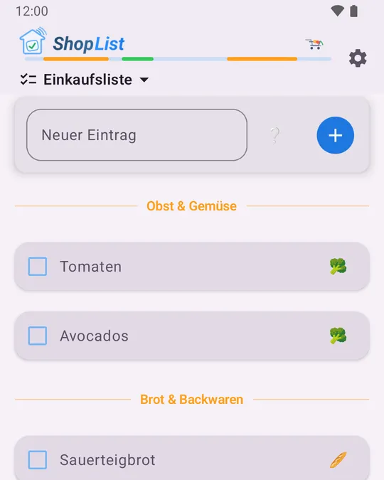
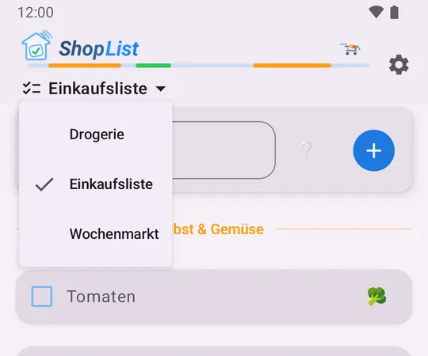
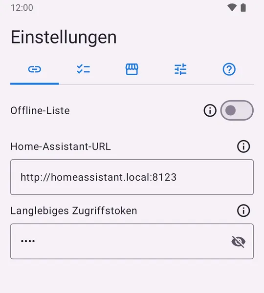
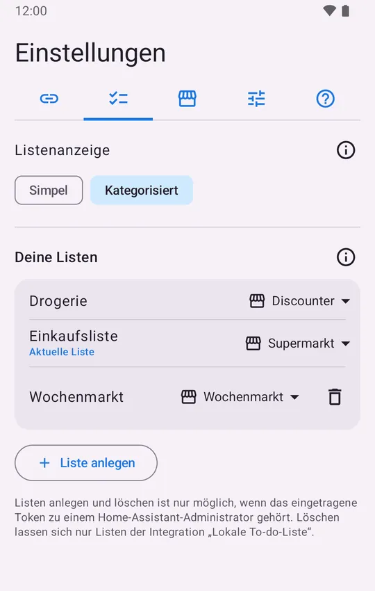
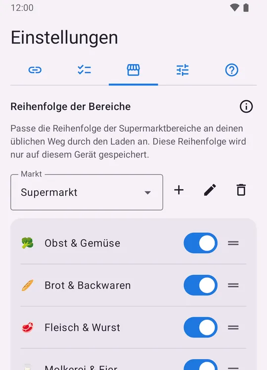
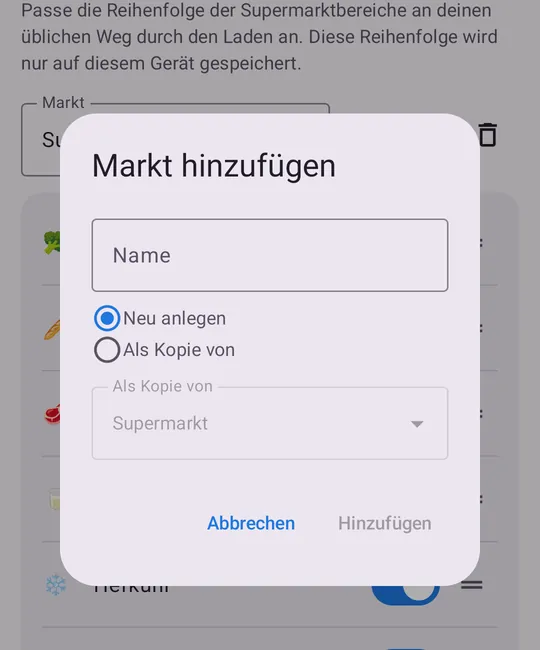
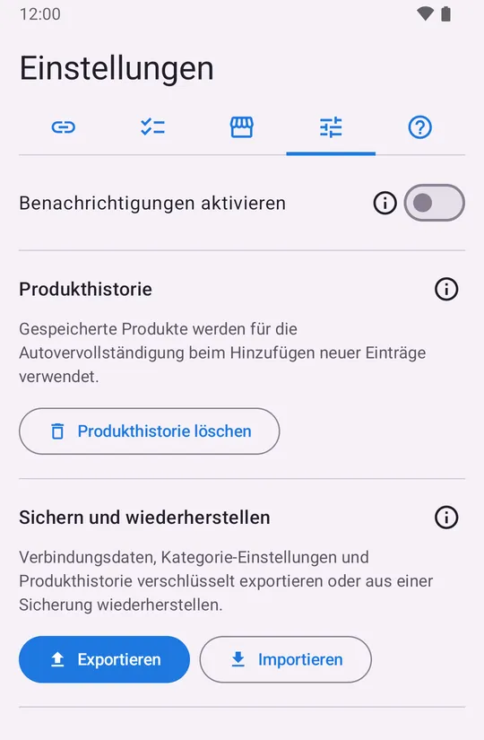
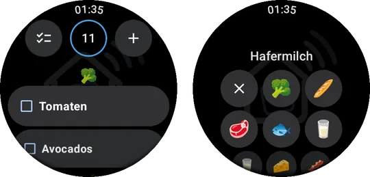

# Hilfe

ShopList zeigt eine Einkaufsliste aus Home Assistant – oder eine Offline-Liste, die nur auf diesem Gerät gespeichert ist. Änderungen werden live mit Home Assistant und allen anderen Geräten abgeglichen. Ohne Verbindung merkt sich die App sie und sendet sie später.

[toc] Inhalt

## Der Hauptbildschirm

- Neue Artikel gibst du im Feld „Neuer Eintrag“ ein. Vorschläge kommen aus deiner Produkthistorie. Das „?“ neben dem Feld wählt den Bereich im Laden, „+“ fügt den Artikel hinzu.
- Ein Tipp auf das Kästchen hakt einen Artikel ab. Ein Tipp auf den Namen bearbeitet ihn, auch seinen Bereich.
- Lange drücken und ziehen sortiert die Liste. Erledigte Artikel sammeln sich unten und werden mit „Erledigte löschen“ entfernt.

### Liste wechseln

Tippe oben links auf den Listennamen. Angeboten werden alle To-do-Listen aus Home Assistant, die aktuelle ist mit Haken markiert.

## Märkte: eine Reihenfolge pro Laden

Jeder Laden ist anders aufgebaut. Ein Markt speichert, in welcher Reihenfolge du die Bereiche abläufst und welche Bereiche es dort gibt.

- Im Laden folgt die Liste deinem Weg – kein Hin- und Herlaufen.
- Bereiche, die es im Laden nicht gibt (z. B. eine Frischetheke beim Discounter), kannst du ausblenden. Sie werden dann für neue Artikel nicht mehr angeboten.
- Beispiel: „Supermarkt“ mit der Bäckerei am Eingang, „Discounter“ mit Getränken zuerst, „Wochenmarkt“ nur mit frischen Lebensmitteln.

## Listen mit Märkten verbinden

Jede Liste hat ihren Markt. Welcher Markt zu welcher Liste gehört, legst du im Reiter „Listen“ fest; Listen ohne Zuordnung verwenden den ersten Markt. Wechselst du die Liste – in der App oder auf der Uhr –, werden ihre Artikel sofort in der Reihenfolge ihres Markts sortiert.

- Beispiel: Liste „Drogerie“ mit Markt „Discounter“, Liste „Wochenmarkt“ mit Markt „Wochenmarkt“. Ein Tipp auf die Liste genügt, und die Reihenfolge stimmt.

## Die Einstellungen

Die Einstellungen haben fünf Reiter. Du wechselst per Tipp auf ein Symbol oder durch seitliches Wischen. Änderungen an Verbindung, Listenanzeige und Märkten übernimmst du mit „Speichern“; Schalter wirken sofort. Das (i) neben vielen Einstellungen erklärt sie ausführlich.

### Verbindung

- Offline-Liste: Die Liste liegt nur auf diesem Gerät, ohne Home Assistant.
- Home-Assistant-URL und langlebiges Zugriffstoken: die Verbindung zu deinem Server. Das Token erstellst du in Home Assistant in deinem Profil unter „Sicherheit“.

### Listen

- Listenanzeige: „Simpel“ zeigt eine flache Liste, „Kategorisiert“ gruppiert die Artikel nach Bereichen in der Reihenfolge des aktiven Markts.
- Deine Listen: alle To-do-Listen aus Home Assistant, jeweils mit ihrem Markt.
- Listen anlegen und löschen geht nur mit dem Token eines Administrators. Löschen lassen sich nur Listen der Integration „Lokale To-do-Liste“ – bei anderen Integrationen würde Home Assistant die ganze Integration entfernen.

### Märkte

- Das Auswahlfeld wählt, welchen Markt du bearbeitest. Der Stift benennt ihn um, der Papierkorb löscht ihn – der letzte Markt bleibt immer erhalten.
- Ziehe Bereiche am Griff in die Reihenfolge deines Weges; der Schalter blendet einen Bereich aus.

„+“ legt einen Markt an: neu mit der Standard-Reihenfolge oder als Kopie eines vorhandenen Markts, den du dann nur noch anpasst.

### Daten

- Benachrichtigungen: Die App reagiert auch im Hintergrund auf Änderungen aus Home Assistant.
- Produkthistorie: Grundlage für die Vorschläge; hier kannst du sie löschen.
- Sichern und wiederherstellen: eine verschlüsselte Datei mit Verbindung, Märkten und Produkthistorie.

## Ohne Verbindung

- Ohne Verbindung kannst du weiter abhaken und hinzufügen. Änderungen bleiben ihrer Liste zugeordnet und werden gesendet, sobald die Verbindung wieder steht.

## Die Uhr (Wear OS)

- Die Uhr übernimmt Verbindung, Listen und Märkte automatisch vom Handy.
- Oben links wechselst du die Liste – das Handy wechselt mit. In der Mitte steht die Zahl der offenen Artikel, „+“ fügt einen Artikel hinzu.
- Ein Tipp auf einen Artikel hakt ihn ab. „Erledigte löschen“ am Ende der Liste entfernt die erledigten Artikel.
- Ohne Verbindung arbeitet die Uhr mit der zuletzt geladenen Liste weiter; der Kreis um die Zahl wird dann orange. Änderungen werden gesendet, sobald die Verbindung wieder steht.
- Die Kachel zeigt die Zahl der offenen Artikel der aktuellen Liste.

### Artikel hinzufügen

- „+“ öffnet die Texteingabe der Uhr – je nach Uhr Tastatur oder Spracheingabe – mit deinen häufigsten Produkten als Vorschläge.
- Bekannte Produkte bekommen ihre Kategorie automatisch.
- Für neue Produkte wählst du die Kategorie per Symbol. Angeboten werden die Kategorien, die im Markt der aktuellen Liste aktiv sind, in seiner Reihenfolge. ✕ fügt den Artikel ohne Kategorie hinzu, „Zurück“ bricht ab.
