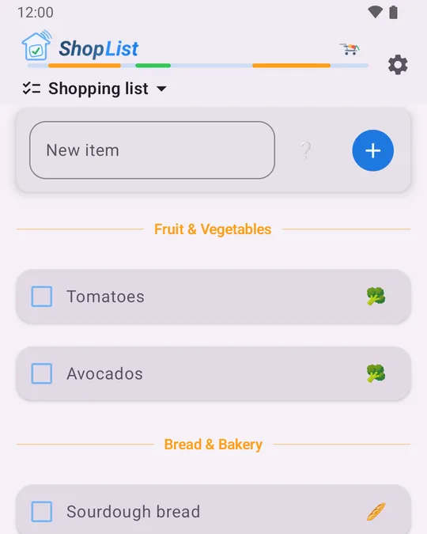
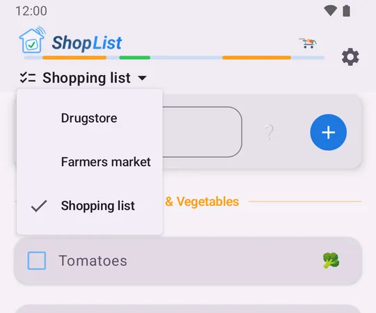
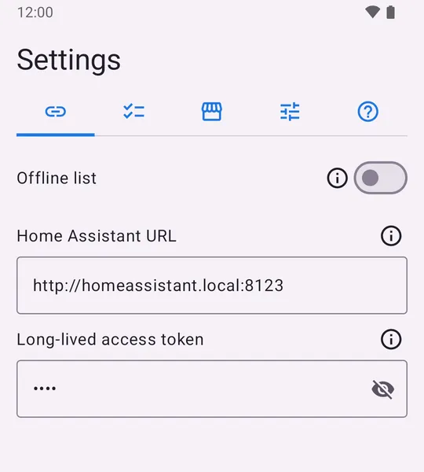
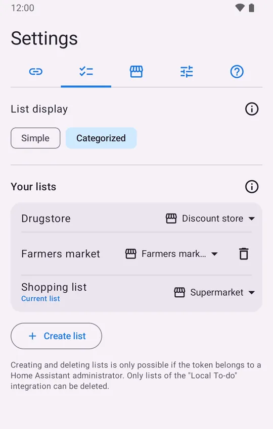
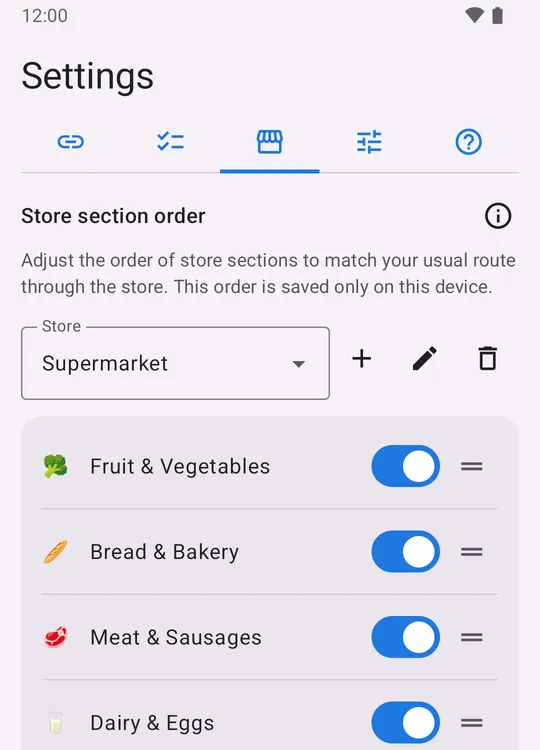
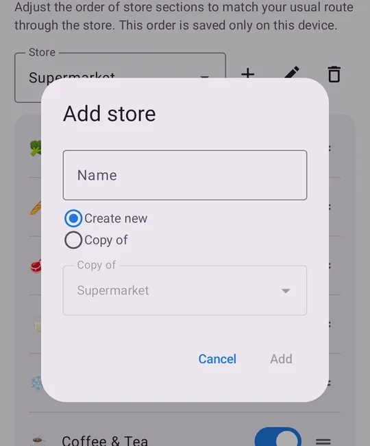
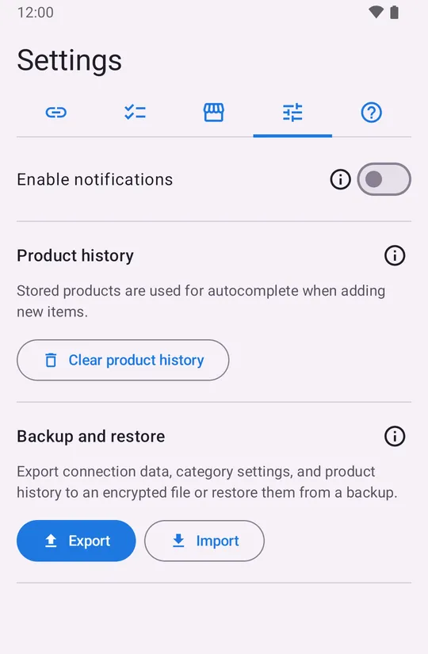
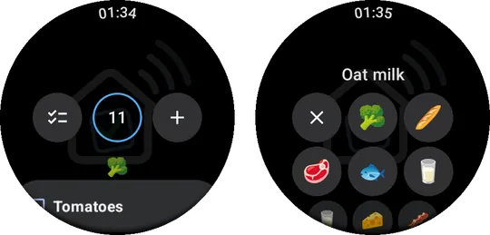

# Help

ShopList shows a shopping list from Home Assistant – or an offline list that is stored only on this device. Changes are synced live with Home Assistant and all other devices. Without a connection the app keeps them and sends them later.

[toc] Contents

## The main screen

- Type new items into the field “New item”. Suggestions come from your product history. The “?” next to the field chooses the section of the store, “+” adds the item.
- Tap the checkbox to tick an item off. Tap the name to edit it, including its section.
- Press and hold an item, then drag it to sort the list. Done items are collected below and removed with “Clear completed”.

### Switching the list

Tap the list name at the top left. All to-do lists from Home Assistant are offered; the current one is ticked.

## Stores: one order per shop

Every shop is laid out differently. A store remembers in which order you walk through the sections and which sections it has.

- In the shop the list follows your route – no walking back and forth.
- Sections a shop doesn’t have (e.g. a deli counter at the discount store) can be hidden. They are then no longer offered for new items.
- Example: “Supermarket” with the bakery at the entrance, “Discount store” with drinks first, “Farmers market” with only fresh food.

## Linking lists and stores

Every list has its store. Which store belongs to which list is set in the “Lists” tab; lists without a store use the first store. When you switch the list – in the app or on the watch – its items are sorted along its store right away.

- Example: list “Drugstore” with store “Discount store”, list “Farmers market” with store “Farmers market”. Tapping the list is enough and the order is right.

## The settings

The settings have five tabs. Tap an icon or swipe sideways to switch. Changes to the connection, the list display and the stores are applied with “Save”; switches take effect right away. The (i) next to many settings explains them in detail.

### Connection

- Offline list: the list is kept only on this device, without Home Assistant.
- Home Assistant URL and long-lived access token: the connection to your server. You create the token in Home Assistant in your profile under “Security”.

### Lists

- List display: “Simple” shows one flat list, “Categorized” groups the items by section in the order of the active store.
- Your lists: all to-do lists from Home Assistant, each with its store.
- Creating and deleting lists needs the token of an administrator. Only lists of the “Local To-do” integration can be deleted – for other integrations Home Assistant would remove the whole integration.

### Stores

- The selection field chooses which store you edit. The pencil renames it, the bin deletes it – the last store is always kept.
- Drag sections by the handle into the order of your route; the switch hides a section.

“+” adds a store: empty with the default order, or as a copy of an existing store, which you then only adjust.

### Data

- Notifications: the app reacts to changes from Home Assistant in the background as well.
- Product history: the basis for suggestions; it can be cleared here.
- Backup and restore: an encrypted file with connection, stores and product history.

## Offline

- Without a connection you can keep ticking off and adding items. Changes stay assigned to their list and are sent as soon as the connection is back.

## The watch (Wear OS)

- The watch takes the connection, lists and stores from the phone automatically.
- At the top left you switch the list – the phone switches too. In the middle you see the number of open items; “+” adds an item.
- Tap an item to tick it off. “Delete completed” at the end of the list removes the completed items.
- Without a connection the watch keeps working with the last loaded list; the circle around the number turns orange. Changes are sent as soon as the connection is back.
- The tile shows the number of open items of the current list.

### Adding items

- “+” opens the watch’s text input – keyboard or voice, depending on the watch – with your most used products as suggestions.
- Known products get their category automatically.
- For new products you pick the category by its icon. You see the categories that are active in the store of the current list, in its order. ✕ adds the item without a category, “Back” cancels.
