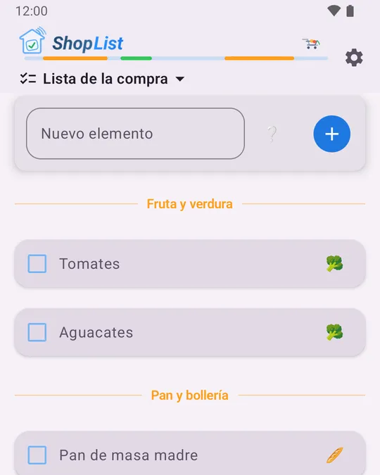
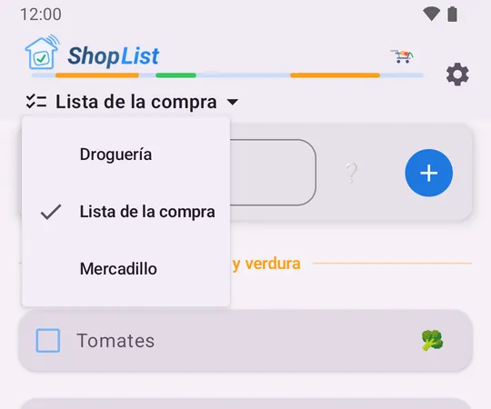
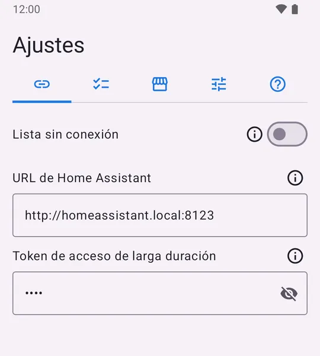
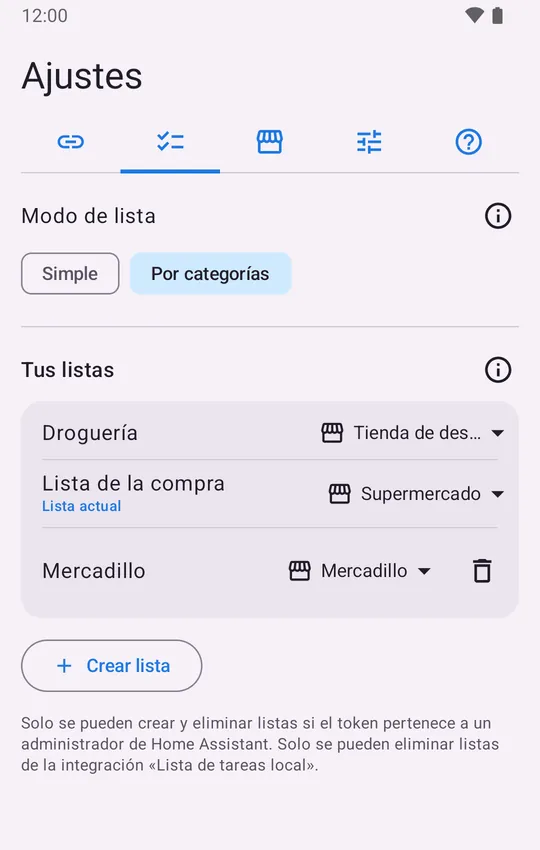
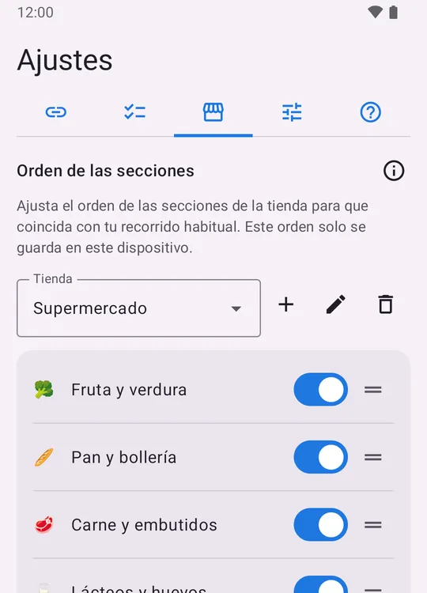
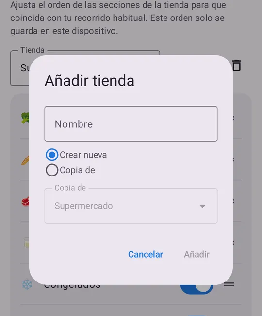
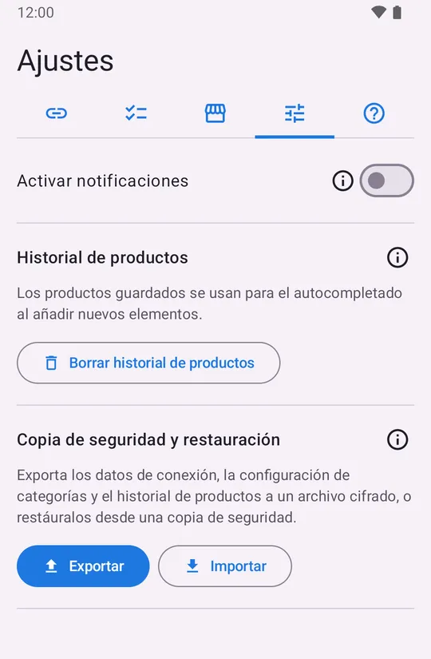
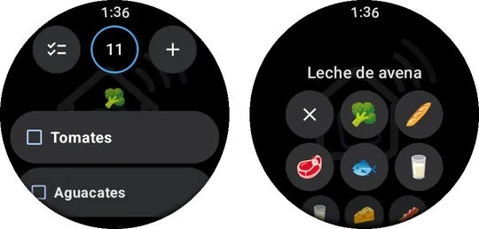

# Ayuda

ShopList muestra una lista de la compra de Home Assistant, o una lista sin conexión guardada solo en este dispositivo. Los cambios se sincronizan al momento con Home Assistant y con los demás dispositivos. Sin conexión, la app los guarda y los envía más tarde.

[toc] Índice

## La pantalla principal

- Escribe los artículos nuevos en el campo «Nuevo elemento». Las sugerencias salen de tu historial de productos. El «?» junto al campo elige la sección de la tienda y «+» añade el artículo.
- Toca la casilla para marcar un artículo. Toca el nombre para editarlo, también su sección.
- Mantén pulsado un artículo y arrástralo para ordenar la lista. Los completados se juntan abajo y se quitan con «Borrar completados».

### Cambiar de lista

Toca el nombre de la lista arriba a la izquierda. Se ofrecen todas las listas de tareas de Home Assistant; la actual está marcada.

## Tiendas: un orden por comercio

Cada comercio está organizado de otra manera. Una tienda guarda en qué orden recorres las secciones y qué secciones tiene.

- En la tienda, la lista sigue tu recorrido, sin ir y venir.
- Las secciones que no existen en un comercio (p. ej. charcutería en la tienda de descuento) se pueden ocultar. Ya no se ofrecen para artículos nuevos.
- Ejemplo: «Supermercado» con la panadería en la entrada, «Tienda de descuento» con las bebidas primero, «Mercadillo» solo con productos frescos.

## Vincular listas y tiendas

Cada lista tiene su tienda. Qué tienda pertenece a cada lista se fija en la pestaña «Listas»; las listas sin tienda usan la primera. Al cambiar de lista –en la app o en el reloj–, sus artículos se ordenan al instante según su tienda.

- Ejemplo: lista «Droguería» con la tienda «Tienda de descuento», lista «Mercadillo» con la tienda «Mercadillo». Basta con tocar la lista y el orden es el correcto.

## Los ajustes

Los ajustes tienen cinco pestañas. Cambias tocando un icono o deslizando de lado. Los cambios en la conexión, la vista de la lista y las tiendas se aplican con «Guardar»; los interruptores actúan al instante. La (i) junto a muchos ajustes los explica en detalle.

### Conexión

- Lista sin conexión: la lista se guarda solo en este dispositivo, sin Home Assistant.
- URL de Home Assistant y token de acceso de larga duración: la conexión con tu servidor. El token se crea en Home Assistant, en tu perfil, en «Seguridad».

### Listas

- Vista de la lista: «Simple» muestra una lista plana; «Por categorías» agrupa los artículos por sección en el orden de la tienda activa.
- Tus listas: todas las listas de tareas de Home Assistant, cada una con su tienda.
- Crear y eliminar listas requiere el token de un administrador. Solo se pueden eliminar listas de la integración «Lista de tareas local»; en otras integraciones Home Assistant eliminaría toda la integración.

### Tiendas

- El campo de selección elige qué tienda editas. El lápiz le cambia el nombre y la papelera la elimina; la última tienda siempre se conserva.
- Arrastra las secciones por el asa en el orden de tu recorrido; el interruptor oculta una sección.

«+» añade una tienda: nueva con el orden predeterminado o como copia de otra que luego solo ajustas.

### Datos

- Notificaciones: la app reacciona también en segundo plano a los cambios de Home Assistant.
- Historial de productos: la base de las sugerencias; aquí se puede borrar.
- Copia de seguridad y restauración: un archivo cifrado con la conexión, las tiendas y el historial de productos.

## Sin conexión

- Sin conexión puedes seguir marcando y añadiendo artículos. Los cambios quedan asignados a su lista y se envían en cuanto vuelve la conexión.

## El reloj (Wear OS)

- El reloj toma la conexión, las listas y las tiendas del teléfono automáticamente.
- Arriba a la izquierda cambias de lista; el teléfono cambia también. En el centro ves el número de artículos pendientes; «+» añade un artículo.
- Toca un artículo para marcarlo. «Borrar completados» al final de la lista quita los artículos marcados.
- Sin conexión, el reloj sigue funcionando con la última lista cargada; el círculo alrededor del número se vuelve naranja. Los cambios se envían en cuanto vuelve la conexión.
- El mosaico muestra el número de artículos pendientes de la lista actual.

### Añadir artículos

- «+» abre la entrada de texto del reloj (teclado o voz, según el reloj) con tus productos más usados como sugerencias.
- Los productos conocidos reciben su categoría automáticamente.
- Para productos nuevos eliges la categoría por su icono. Se ofrecen las categorías activas en la tienda de la lista actual, en su orden. ✕ añade el artículo sin categoría; «Atrás» cancela.
