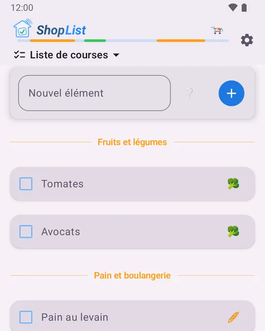
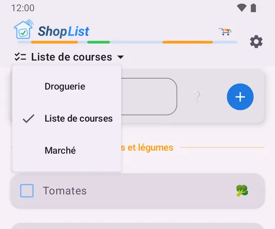
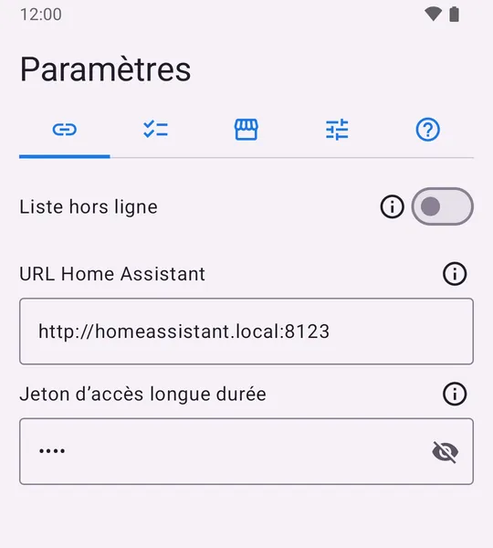
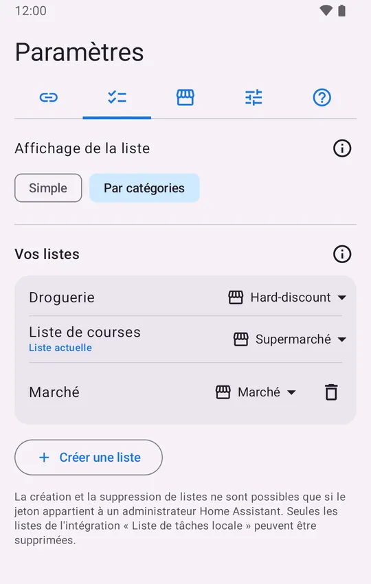
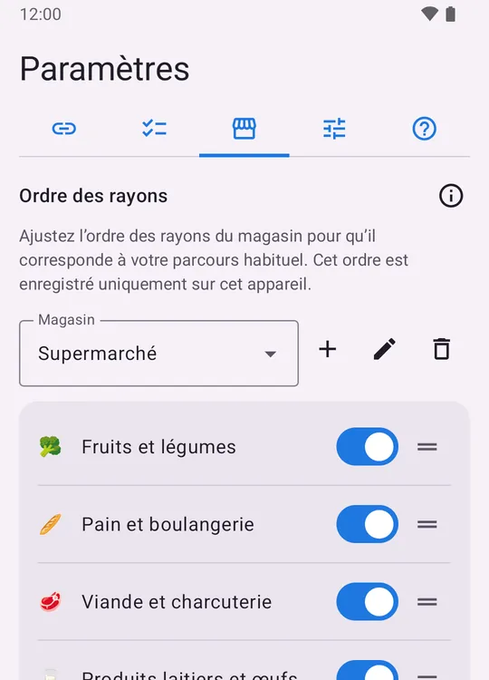
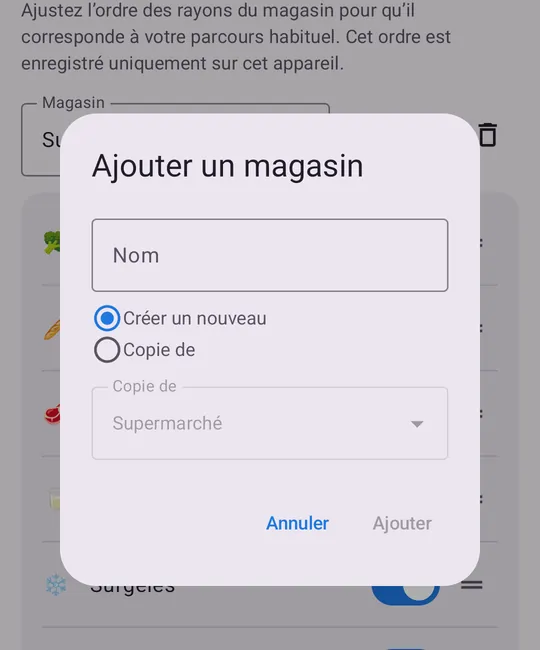
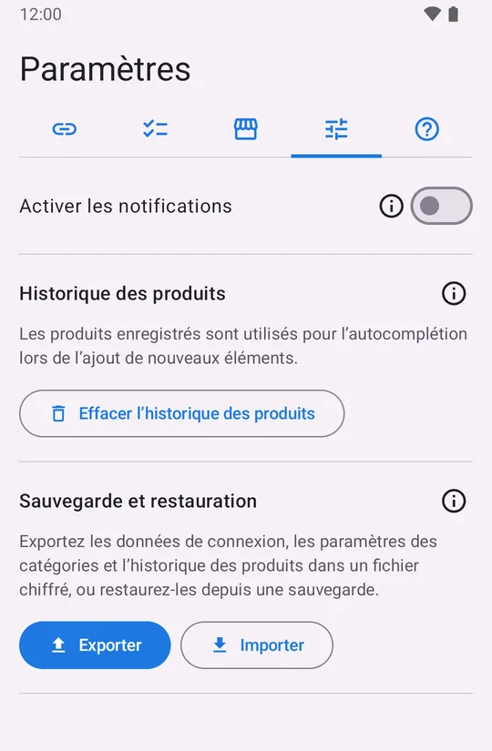
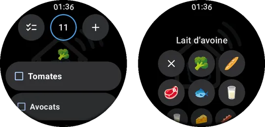

# Aide

ShopList affiche une liste de courses de Home Assistant, ou une liste hors ligne enregistrée uniquement sur cet appareil. Les modifications sont synchronisées en direct avec Home Assistant et les autres appareils. Sans connexion, l’application les garde et les envoie plus tard.

[toc] Sommaire

## L’écran principal

- Saisissez les nouveaux articles dans le champ « Nouvel élément ». Les suggestions viennent de votre historique des produits. Le « ? » à côté du champ choisit le rayon, « + » ajoute l’article.
- Touchez la case pour cocher un article. Touchez le nom pour le modifier, y compris son rayon.
- Appuyez longuement sur un article puis faites-le glisser pour trier la liste. Les articles terminés sont regroupés en bas et retirés avec « Supprimer les éléments terminés ».

### Changer de liste

Touchez le nom de la liste en haut à gauche. Toutes les listes de tâches de Home Assistant sont proposées ; la liste actuelle est cochée.

## Magasins : un ordre par boutique

Chaque boutique est organisée différemment. Un magasin mémorise l’ordre dans lequel vous parcourez les rayons et les rayons qu’il propose.

- En magasin, la liste suit votre parcours, sans allers-retours.
- Les rayons qu’une boutique n’a pas (p. ex. un rayon traiteur au hard-discount) peuvent être masqués. Ils ne sont alors plus proposés pour les nouveaux articles.
- Exemple : « Supermarché » avec la boulangerie à l’entrée, « Hard-discount » avec les boissons d’abord, « Marché » avec uniquement des produits frais.

## Associer listes et magasins

Chaque liste a son magasin. Le magasin de chaque liste se définit dans l’onglet « Listes » ; les listes sans magasin utilisent le premier. Quand vous changez de liste – dans l’application ou sur la montre –, ses articles sont aussitôt triés selon son magasin.

- Exemple : liste « Droguerie » avec le magasin « Hard-discount », liste « Marché » avec le magasin « Marché ». Un toucher sur la liste suffit et l’ordre est bon.

## Les paramètres

Les paramètres ont cinq onglets. Touchez une icône ou balayez sur le côté pour changer. Les modifications de la connexion, de l’affichage de la liste et des magasins sont appliquées avec « Enregistrer » ; les interrupteurs agissent tout de suite. Le (i) à côté de nombreux paramètres les explique en détail.

### Connexion

- Liste hors ligne : la liste reste uniquement sur cet appareil, sans Home Assistant.
- URL de Home Assistant et jeton d’accès longue durée : la connexion à votre serveur. Créez le jeton dans Home Assistant, dans votre profil, sous « Sécurité ».

### Listes

- Affichage de la liste : « Simple » affiche une liste à plat, « Par catégories » regroupe les articles par rayon dans l’ordre du magasin actif.
- Vos listes : toutes les listes de tâches de Home Assistant, chacune avec son magasin.
- Créer et supprimer des listes nécessite le jeton d’un administrateur. Seules les listes de l’intégration « Liste de tâches locale » peuvent être supprimées ; pour les autres intégrations, Home Assistant supprimerait toute l’intégration.

### Magasins

- Le champ de sélection choisit le magasin que vous modifiez. Le crayon le renomme, la corbeille le supprime ; le dernier magasin est toujours conservé.
- Faites glisser les rayons par la poignée dans l’ordre de votre parcours ; l’interrupteur masque un rayon.

« + » ajoute un magasin : vide avec l’ordre par défaut, ou en copie d’un magasin existant que vous n’avez plus qu’à ajuster.

### Données

- Notifications : l’application réagit aussi en arrière-plan aux modifications venant de Home Assistant.
- Historique des produits : la base des suggestions ; il peut être effacé ici.
- Sauvegarde et restauration : un fichier chiffré avec la connexion, les magasins et l’historique des produits.

## Hors ligne

- Sans connexion, vous pouvez continuer à cocher et ajouter des articles. Les modifications restent liées à leur liste et sont envoyées dès que la connexion revient.

## La montre (Wear OS)

- La montre reprend automatiquement la connexion, les listes et les magasins du téléphone.
- En haut à gauche, vous changez de liste ; le téléphone suit. Au centre, vous voyez le nombre d’articles restants ; « + » ajoute un article.
- Touchez un article pour le cocher. « Supprimer les éléments terminés » en fin de liste retire les articles cochés.
- Sans connexion, la montre continue avec la dernière liste chargée ; le cercle autour du nombre devient orange. Les modifications sont envoyées dès que la connexion revient.
- La vignette affiche le nombre d’articles restants de la liste actuelle.

### Ajouter des articles

- « + » ouvre la saisie de texte de la montre – clavier ou voix selon la montre – avec vos produits les plus utilisés en suggestions.
- Les produits connus reçoivent automatiquement leur catégorie.
- Pour un nouveau produit, vous choisissez la catégorie par son icône. Sont proposées les catégories actives dans le magasin de la liste actuelle, dans son ordre. ✕ ajoute l’article sans catégorie, « Retour » annule.
