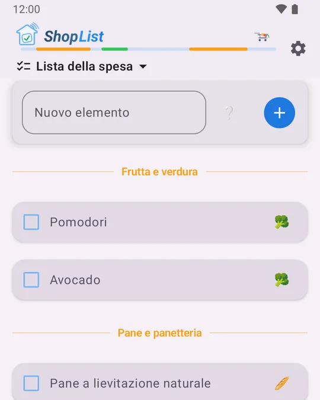
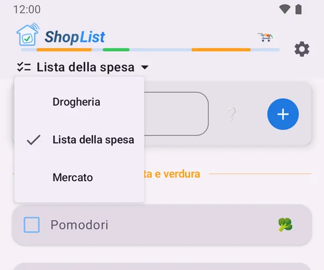
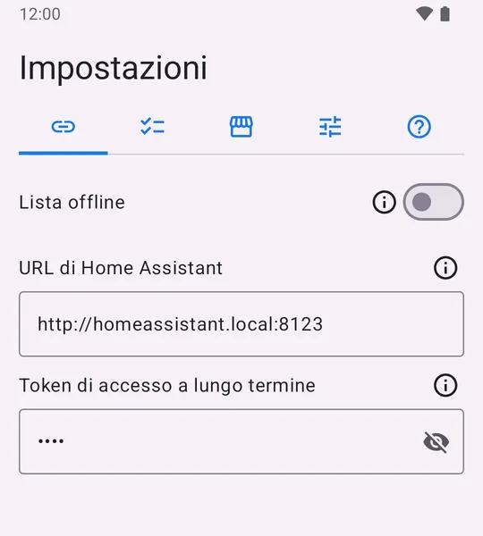
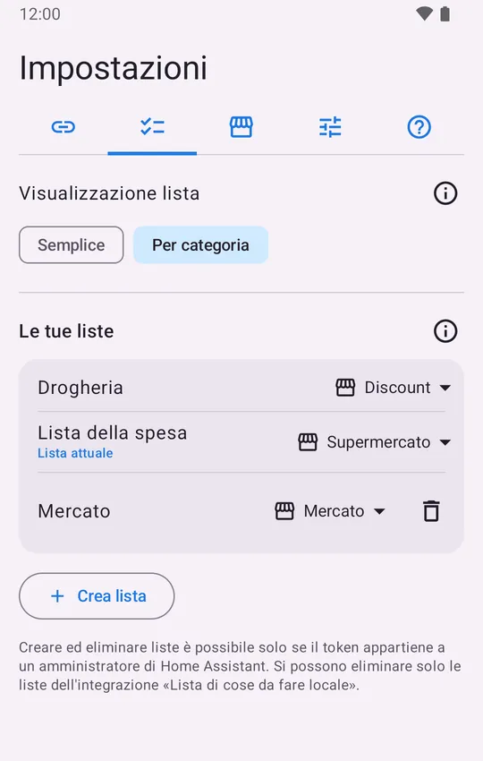
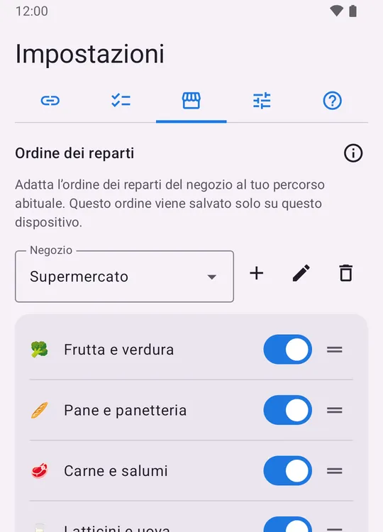
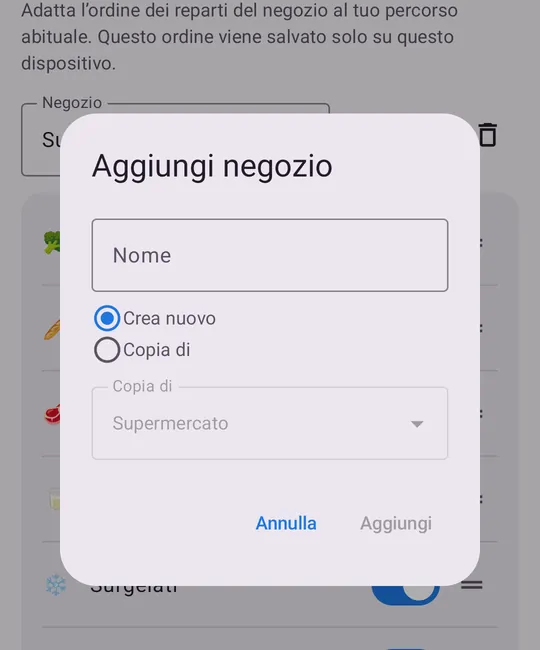
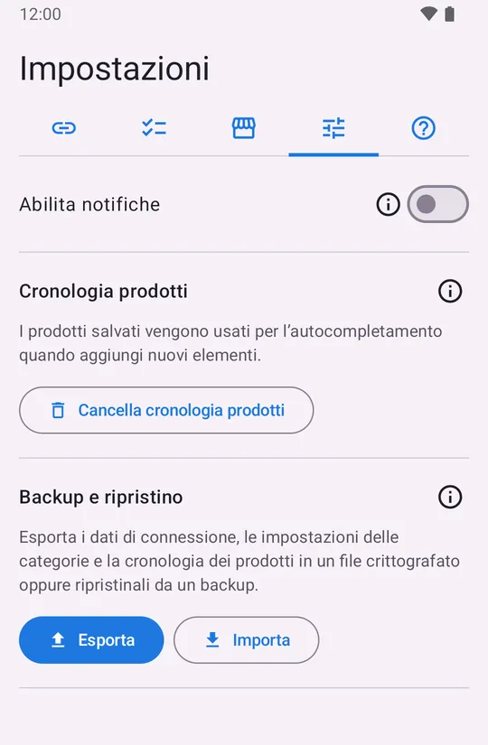
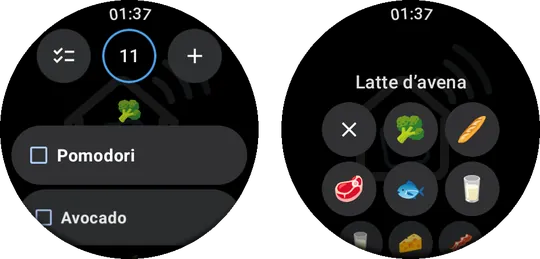

# Guida

ShopList mostra una lista della spesa di Home Assistant, oppure una lista offline salvata solo su questo dispositivo. Le modifiche vengono sincronizzate in tempo reale con Home Assistant e con gli altri dispositivi. Senza connessione l’app le conserva e le invia più tardi.

[toc] Indice

## La schermata principale

- Inserisci i nuovi articoli nel campo «Nuovo elemento». I suggerimenti vengono dalla cronologia prodotti. Il «?» accanto al campo sceglie il reparto, «+» aggiunge l’articolo.
- Tocca la casella per spuntare un articolo. Tocca il nome per modificarlo, anche il suo reparto.
- Tieni premuto un articolo e trascinalo per ordinare la lista. Gli articoli completati finiscono in basso e si rimuovono con «Elimina completati».

### Cambiare lista

Tocca il nome della lista in alto a sinistra. Vengono proposte tutte le liste di cose da fare di Home Assistant; quella attuale è spuntata.

## Negozi: un ordine per ogni punto vendita

Ogni punto vendita è organizzato in modo diverso. Un negozio memorizza in quale ordine percorri i reparti e quali reparti ci sono.

- Nel negozio la lista segue il tuo percorso, senza andare avanti e indietro.
- I reparti che un negozio non ha (ad es. una gastronomia al discount) si possono nascondere. Non vengono più proposti per i nuovi articoli.
- Esempio: «Supermercato» con il panificio all’ingresso, «Discount» con le bevande per prime, «Mercato» solo con prodotti freschi.

## Collegare liste e negozi

Ogni lista ha il suo negozio. Quale negozio appartiene a quale lista si imposta nella scheda «Liste»; le liste senza negozio usano il primo. Quando cambi lista – nell’app o sull’orologio –, i suoi articoli vengono subito ordinati secondo il suo negozio.

- Esempio: lista «Drogheria» con il negozio «Discount», lista «Mercato» con il negozio «Mercato». Basta toccare la lista e l’ordine è giusto.

## Le impostazioni

Le impostazioni hanno cinque schede. Cambi scheda toccando un’icona o scorrendo di lato. Le modifiche a connessione, visualizzazione della lista e negozi si applicano con «Salva»; gli interruttori agiscono subito. La (i) accanto a molte impostazioni le spiega in dettaglio.

### Connessione

- Lista offline: la lista resta solo su questo dispositivo, senza Home Assistant.
- URL di Home Assistant e token di accesso a lungo termine: la connessione al tuo server. Il token si crea in Home Assistant nel tuo profilo, alla voce «Sicurezza».

### Liste

- Visualizzazione lista: «Semplice» mostra una lista unica, «Per categoria» raggruppa gli articoli per reparto nell’ordine del negozio attivo.
- Le tue liste: tutte le liste di cose da fare di Home Assistant, ognuna con il suo negozio.
- Creare ed eliminare liste richiede il token di un amministratore. Si possono eliminare solo le liste dell’integrazione «Lista di cose da fare locale»; per altre integrazioni Home Assistant rimuoverebbe l’intera integrazione.

### Negozi

- Il campo di selezione sceglie quale negozio modificare. La matita lo rinomina, il cestino lo elimina; l’ultimo negozio resta sempre.
- Trascina i reparti dalla maniglia nell’ordine del tuo percorso; l’interruttore nasconde un reparto.

«+» aggiunge un negozio: nuovo con l’ordine predefinito, oppure come copia di un negozio esistente da adattare soltanto.

### Dati

- Notifiche: l’app reagisce anche in background alle modifiche di Home Assistant.
- Cronologia prodotti: la base dei suggerimenti; qui si può cancellare.
- Backup e ripristino: un file cifrato con connessione, negozi e cronologia prodotti.

## Offline

- Senza connessione puoi continuare a spuntare e aggiungere articoli. Le modifiche restano assegnate alla loro lista e vengono inviate appena la connessione torna.

## L’orologio (Wear OS)

- L’orologio riprende automaticamente dal telefono connessione, liste e negozi.
- In alto a sinistra cambi lista; il telefono la cambia insieme. Al centro vedi il numero di articoli ancora da prendere; «+» aggiunge un articolo.
- Tocca un articolo per spuntarlo. «Elimina completati» in fondo alla lista rimuove gli articoli spuntati.
- Senza connessione l’orologio continua con l’ultima lista caricata; il cerchio intorno al numero diventa arancione. Le modifiche vengono inviate appena la connessione torna.
- Il riquadro mostra il numero di articoli ancora da prendere della lista attuale.

### Aggiungere articoli

- «+» apre l’inserimento di testo dell’orologio – tastiera o voce, a seconda dell’orologio – con i tuoi prodotti più usati come suggerimenti.
- I prodotti già noti ricevono automaticamente la loro categoria.
- Per i prodotti nuovi scegli la categoria tramite la sua icona. Vengono proposte le categorie attive nel negozio della lista attuale, nel suo ordine. ✕ aggiunge l’articolo senza categoria, «Indietro» annulla.
