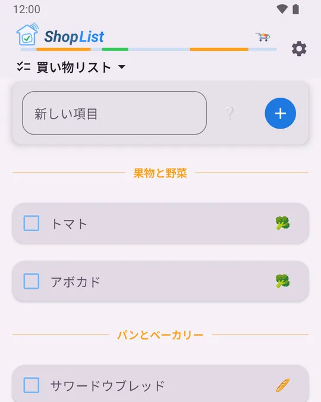
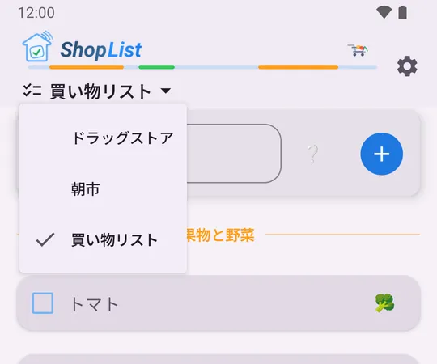
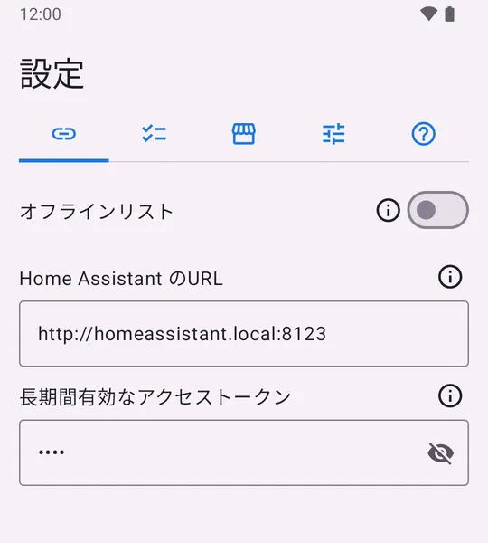
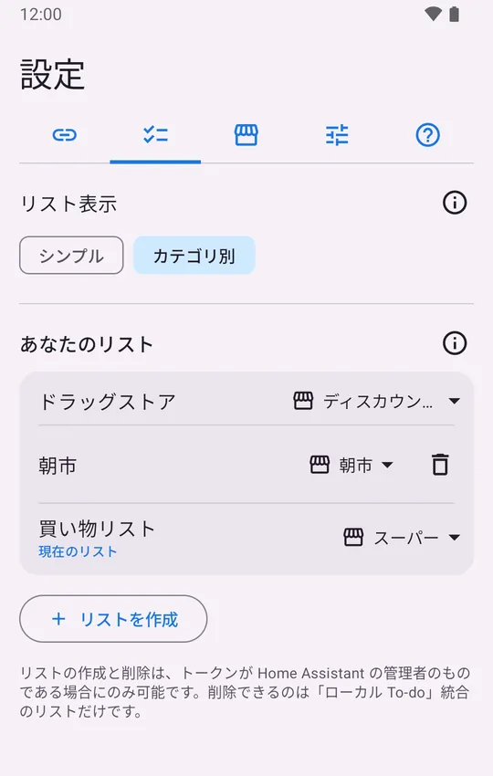
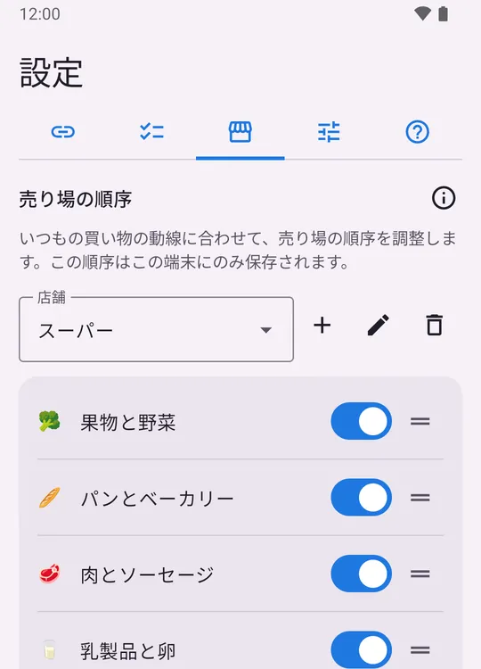
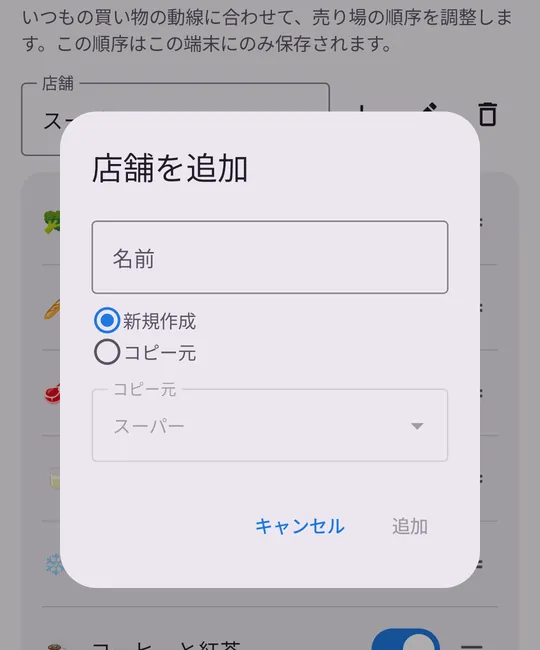
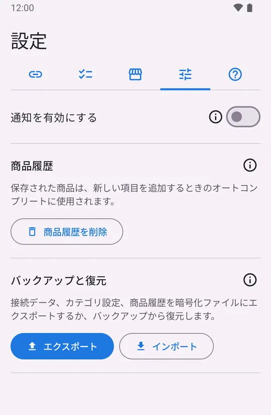
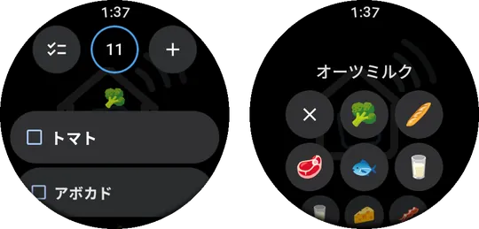

# ヘルプ

ShopList は Home Assistant の買い物リスト、またはこの端末だけに保存されるオフラインリストを表示します。変更は Home Assistant やほかの端末とリアルタイムで同期されます。接続がないときは変更を保存し、あとで送信します。

[toc] 目次

## メイン画面

- 新しいアイテムは「新しい項目」欄に入力します。候補は商品履歴から表示されます。欄の横の「?」で売り場を選び、「+」で追加します。
- チェックボックスをタップすると完了になります。名前をタップすると売り場も含めて編集できます。
- アイテムを長押ししてドラッグすると並べ替えられます。完了したアイテムは下にまとまり、「完了した項目を削除」で消せます。

### リストの切り替え

左上のリスト名をタップします。Home Assistant のすべての To-do リストが表示され、現在のリストにチェックが付いています。

## 店舗：お店ごとの順番

お店の売り場の配置はそれぞれ違います。店舗には、売り場を回る順番と、どの売り場があるかが保存されます。

- 店内ではリストが順路どおりに並ぶので、行ったり来たりしません。
- お店にない売り場（例：ディスカウント店の総菜コーナー）は非表示にできます。新しいアイテムの選択肢にも出なくなります。
- 例：入口にパン売り場がある「スーパー」、飲み物が最初の「ディスカウント店」、生鮮食品だけの「朝市」。

## リストと店舗をつなぐ

各リストには店舗があります。どのリストにどの店舗を使うかは「リスト」タブで設定し、店舗が割り当てられていないリストは最初の店舗を使います。アプリでもウォッチでも、リストを切り替えるとアイテムがすぐにその店舗の順番で並びます。

- 例：リスト「ドラッグストア」と店舗「ディスカウント店」、リスト「朝市」と店舗「朝市」。リストをタップするだけで順番が合います。

## 設定

設定には5つのタブがあります。アイコンをタップするか、横にスワイプして切り替えます。接続、リスト表示、店舗の変更は「保存」で反映され、スイッチはすぐに有効になります。多くの設定の横にある (i) で詳しい説明を見られます。

### 接続

- オフラインリスト：Home Assistant を使わず、この端末だけにリストを保存します。
- Home Assistant の URL と長期間有効なアクセストークン：サーバーへの接続です。トークンは Home Assistant のプロフィールの「セキュリティ」で作成します。

### リスト

- リスト表示：「シンプル」は1つのリスト、「カテゴリ別」は有効な店舗の順番で売り場ごとにまとめます。
- あなたのリスト：Home Assistant のすべての To-do リストと、それぞれの店舗です。
- リストの作成と削除には管理者のトークンが必要です。削除できるのは「ローカル To-do」統合のリストだけです。ほかの統合では Home Assistant が統合全体を削除してしまいます。

### 店舗

- 選択欄で編集する店舗を選びます。鉛筆で名前を変更し、ごみ箱で削除します。最後の店舗は常に残ります。
- ハンドルで売り場を順路の順番にドラッグします。スイッチで売り場を非表示にします。

「+」で店舗を追加します。既定の順番で新規作成するか、既存の店舗をコピーして調整します。

### データ

- 通知：バックグラウンドでも Home Assistant の変更に反応します。
- 商品履歴：候補のもとになります。ここで消去できます。
- バックアップと復元：接続、店舗、商品履歴を含む暗号化ファイルです。

## ホーム画面ウィジェット

4 種類のウィジェットでリストをホーム画面に置けます。ホーム画面を長押し → ウィジェット → HomeShopList。どれもアプリの現在のリストを表示し、サイズを変更できます。

- 「買い物リスト」：入力欄・カテゴリ選択・リスト切り替え付きのリスト。
- 「リスト」：買い物リストのみ。
- 「クイック追加」：カテゴリ選択付きの入力欄のみ。
- 「リスト切り替え」：現在のリストと未完了の項目数を表示し、リストを切り替えます。

### 使い方

- チェックボックスをタップすると項目を完了にしたり、元に戻したりできます。完了した項目の下の「完了した項目を削除」で、確認後にまとめて削除します。
- 入力欄をタップすると、ウィジェットのすぐ上に入力欄が開き、商品履歴からの候補が表示されます。開いたままなので、続けて複数の項目を追加できます。
- 入力欄の横の記号で、新しい項目のカテゴリを選びます。
- リスト名をタップするとリストを切り替えます。切り替えはアプリとすべてのウィジェットに反映されます。
- 右上の家と矢印でアプリを開きます。
- アプリの実行中はウィジェットがすぐに更新されます。それ以外は、操作したときと約 30 分ごとに更新されます。

## オフライン

- 接続がなくても、チェックや追加を続けられます。変更はそのリストに紐づいたまま、接続が戻るとすぐに送信されます。

## ウォッチ（Wear OS）

- ウォッチは接続、リスト、店舗をスマートフォンから自動的に受け取ります。
- 左上でリストを切り替えると、スマートフォンも一緒に切り替わります。中央に未完了のアイテム数が表示され、「+」でアイテムを追加します。
- アイテムをタップするとチェックが付きます。リストの最後にある「完了した項目を削除」で完了したアイテムを削除します。
- 接続がなくても、ウォッチは最後に読み込んだリストで動作し、数字の周りの円がオレンジになります。変更は接続が戻るとすぐに送信されます。
- タイルには現在のリストの未完了アイテム数が表示されます。

### アイテムの追加

- 「+」でウォッチの文字入力（ウォッチによりキーボードまたは音声）が開き、よく使う商品が候補として表示されます。
- 既知の商品には自動的にカテゴリが付きます。
- 新しい商品はアイコンでカテゴリを選びます。表示されるのは現在のリストの店舗で有効なカテゴリで、その店舗の順番です。✕ はカテゴリなしで追加し、「戻る」で取り消します。
