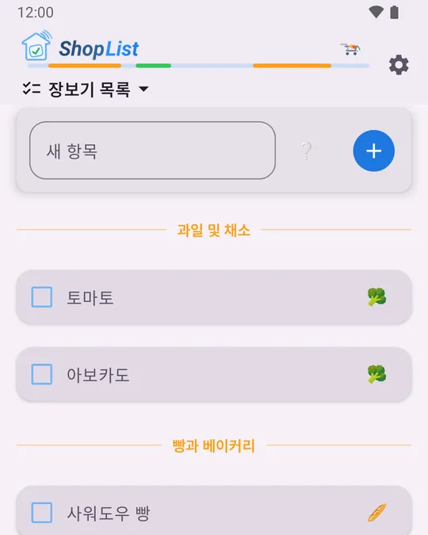
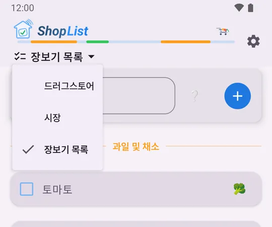
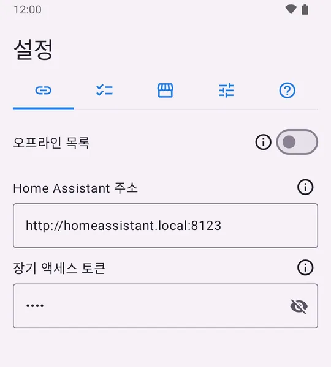
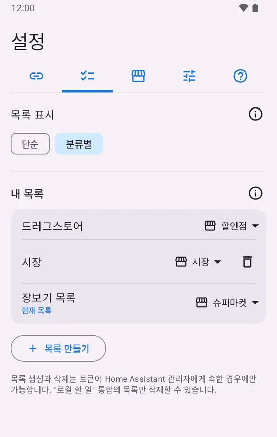
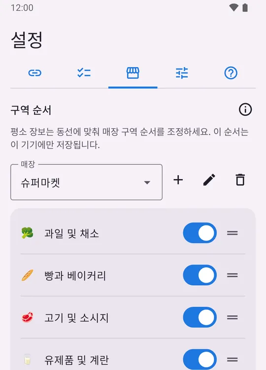
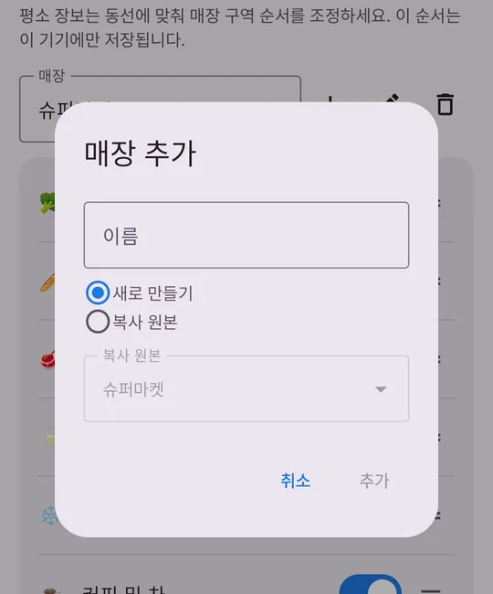
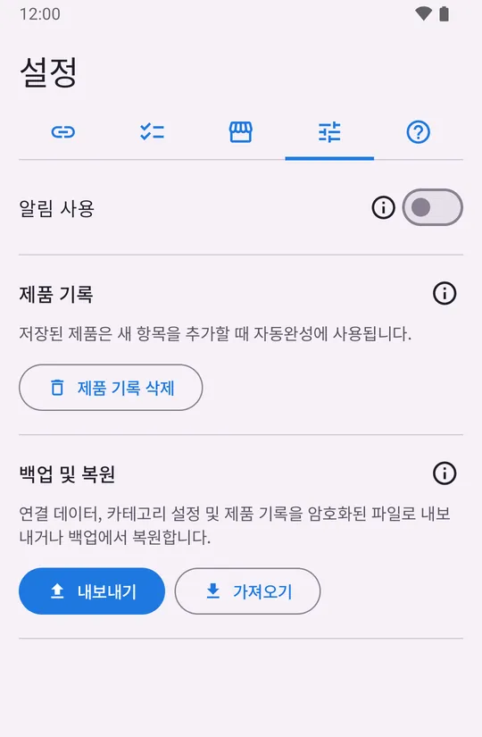
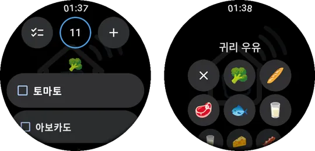

# 도움말

ShopList는 Home Assistant의 장보기 목록이나 이 기기에만 저장되는 오프라인 목록을 보여 줍니다. 변경 사항은 Home Assistant 및 다른 기기와 실시간으로 동기화됩니다. 연결이 없으면 앱이 변경 사항을 보관했다가 나중에 보냅니다.

[toc] 목차

## 메인 화면

- 새 항목은 “새 항목” 칸에 입력합니다. 추천은 제품 기록에서 나옵니다. 칸 옆의 “?”로 매장 구역을 고르고 “+”로 추가합니다.
- 체크박스를 탭하면 항목이 완료됩니다. 이름을 탭하면 구역을 포함해 편집할 수 있습니다.
- 항목을 길게 누른 채 끌어서 목록을 정렬합니다. 완료된 항목은 아래에 모이고 “완료 항목 삭제”로 지웁니다.

### 목록 바꾸기

왼쪽 위의 목록 이름을 탭합니다. Home Assistant의 모든 할 일 목록이 나오고 현재 목록에 체크 표시가 있습니다.

## 매장: 가게마다 하나의 순서

가게마다 구조가 다릅니다. 매장은 구역을 도는 순서와 어떤 구역이 있는지를 저장합니다.

- 가게 안에서 목록이 동선을 따라가므로 왔다 갔다 하지 않아도 됩니다.
- 가게에 없는 구역(예: 할인점의 델리 코너)은 숨길 수 있습니다. 새 항목의 선택지에도 나오지 않습니다.
- 예: 입구에 빵 코너가 있는 “슈퍼마켓”, 음료가 먼저인 “할인점”, 신선 식품만 있는 “시장”.

## 목록과 매장 연결

목록마다 매장이 있습니다. 어느 목록에 어느 매장을 쓸지는 “목록” 탭에서 정하며, 매장이 지정되지 않은 목록은 첫 번째 매장을 사용합니다. 앱이나 워치에서 목록을 바꾸면 항목이 바로 그 매장의 순서로 정렬됩니다.

- 예: 목록 “드러그스토어”와 매장 “할인점”, 목록 “시장”과 매장 “시장”. 목록만 탭하면 순서가 맞습니다.

## 설정

설정에는 다섯 개의 탭이 있습니다. 아이콘을 탭하거나 옆으로 밀어서 바꿉니다. 연결, 목록 표시, 매장 변경은 “저장”으로 적용되고 스위치는 바로 적용됩니다. 여러 설정 옆의 (i)에서 자세한 설명을 볼 수 있습니다.

### 연결

- 오프라인 목록: Home Assistant 없이 이 기기에만 목록을 저장합니다.
- Home Assistant URL과 장기 액세스 토큰: 서버와의 연결입니다. 토큰은 Home Assistant 프로필의 “보안”에서 만듭니다.

### 목록

- 목록 표시: “단순”은 하나의 목록으로, “분류별”은 활성 매장의 순서에 따라 구역별로 묶어서 보여 줍니다.
- 내 목록: Home Assistant의 모든 할 일 목록과 각 목록의 매장입니다.
- 목록 생성과 삭제에는 관리자 토큰이 필요합니다. “로컬 할 일” 통합의 목록만 삭제할 수 있습니다. 다른 통합에서는 Home Assistant가 통합 전체를 삭제하기 때문입니다.

### 매장

- 선택 필드에서 편집할 매장을 고릅니다. 연필은 이름 변경, 휴지통은 삭제이며 마지막 매장은 항상 남습니다.
- 손잡이로 구역을 동선 순서대로 끕니다. 스위치는 구역을 숨깁니다.

“+”로 매장을 추가합니다. 기본 순서로 새로 만들거나 기존 매장을 복사해 조금만 고칩니다.

### 데이터

- 알림: 백그라운드에서도 Home Assistant의 변경에 반응합니다.
- 제품 기록: 추천의 바탕이 되며 여기서 지울 수 있습니다.
- 백업 및 복원: 연결, 매장, 제품 기록이 담긴 암호화 파일입니다.

## 홈 화면 위젯

네 가지 위젯으로 목록을 홈 화면에 둘 수 있습니다. 홈 화면을 길게 누르기 → 위젯 → HomeShopList. 모두 앱의 현재 목록을 표시하며 크기를 조절할 수 있습니다.

- "장보기 목록": 입력란, 카테고리 선택, 목록 전환이 있는 목록.
- "목록": 장보기 목록만.
- "빠른 추가": 카테고리 선택이 있는 입력란만.
- "목록 전환": 현재 목록과 남은 항목 수를 표시하고 목록을 전환합니다.

### 사용 방법

- 체크박스를 탭하면 항목을 완료하거나 다시 해제합니다. 완료된 항목 아래의 "완료 항목 삭제"는 확인 후 이를 삭제합니다.
- 입력란을 탭하면 위젯 바로 위에 입력창이 열리고 제품 기록의 추천 항목이 표시됩니다. 열린 상태로 유지되므로 여러 항목을 연달아 추가할 수 있습니다.
- 입력란 옆의 기호로 새 항목의 카테고리를 선택합니다.
- 목록 이름을 탭하면 목록이 전환됩니다. 전환은 앱과 모든 위젯에 적용됩니다.
- 오른쪽 위의 집과 화살표를 누르면 앱이 열립니다.
- 앱이 실행 중이면 위젯이 바로 업데이트됩니다. 그렇지 않으면 사용할 때와 약 30분마다 업데이트됩니다.

## 오프라인

- 연결이 없어도 계속 체크하고 추가할 수 있습니다. 변경 사항은 해당 목록에 연결된 채로 있다가 연결이 돌아오면 바로 전송됩니다.

## 워치(Wear OS)

- 워치는 연결, 목록, 매장을 휴대전화에서 자동으로 가져옵니다.
- 왼쪽 위에서 목록을 바꾸면 휴대전화도 함께 바뀝니다. 가운데에 남은 항목 수가 표시되고, „+“로 항목을 추가합니다.
- 항목을 탭하면 체크됩니다. 목록 끝의 „완료 항목 삭제“로 완료된 항목을 지웁니다.
- 연결이 없어도 워치는 마지막으로 불러온 목록으로 계속 작동하며, 숫자 주위의 원이 주황색으로 바뀝니다. 변경 사항은 연결이 돌아오면 바로 전송됩니다.
- 타일에는 현재 목록의 남은 항목 수가 표시됩니다.

### 항목 추가

- „+“를 누르면 워치의 텍스트 입력(워치에 따라 키보드 또는 음성)이 열리고, 자주 쓰는 상품이 추천으로 표시됩니다.
- 알려진 상품은 카테고리가 자동으로 지정됩니다.
- 새 상품은 아이콘으로 카테고리를 고릅니다. 현재 목록의 매장에서 활성화된 카테고리가 그 매장의 순서대로 표시됩니다. ✕는 카테고리 없이 추가하고, „뒤로“는 취소합니다.
