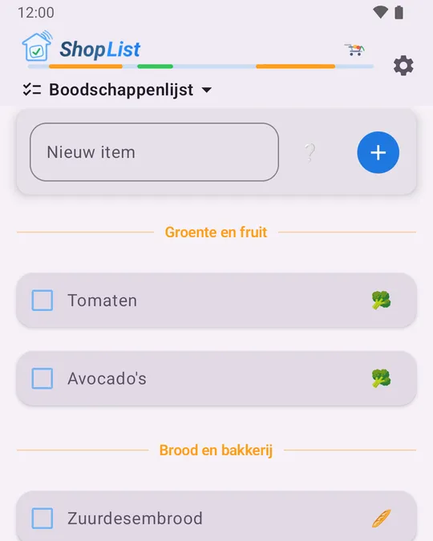
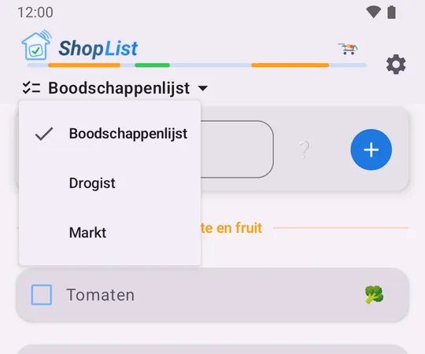
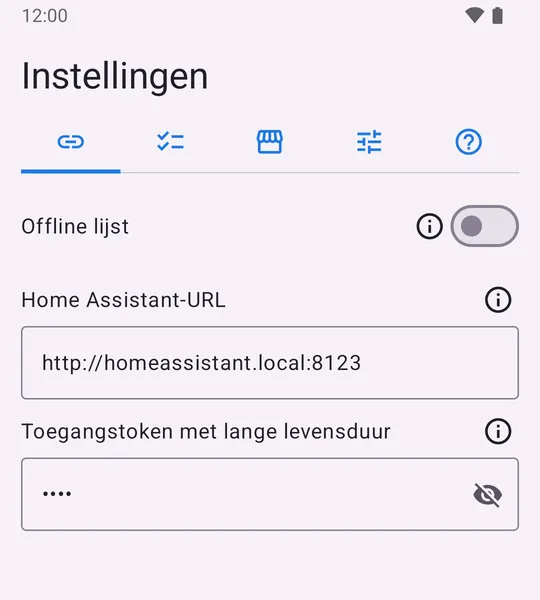
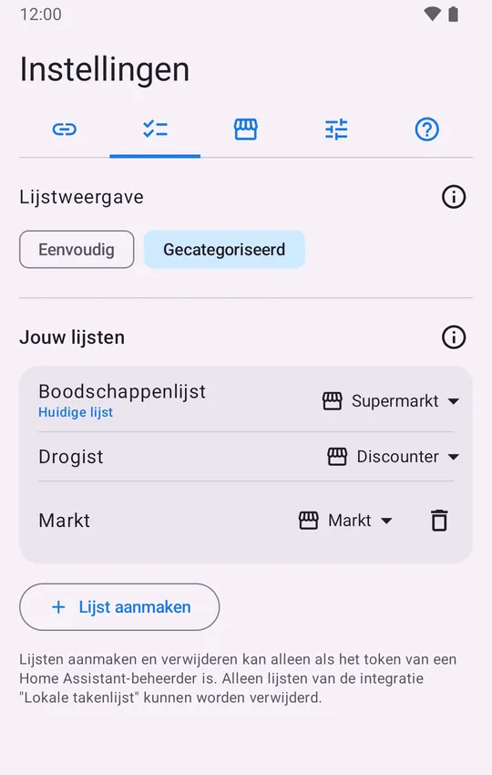
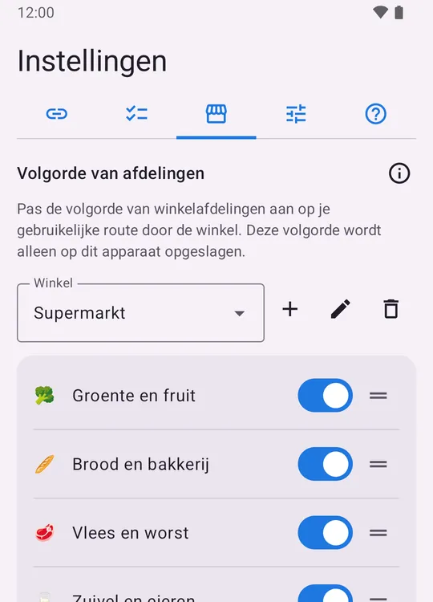
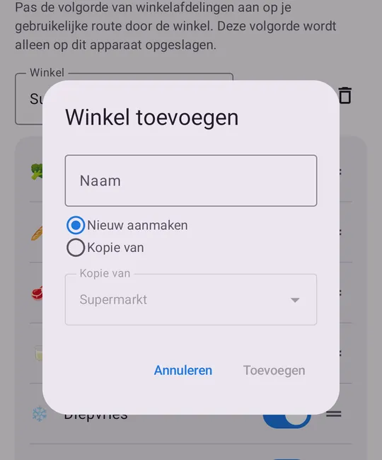
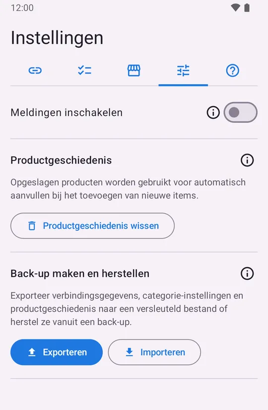
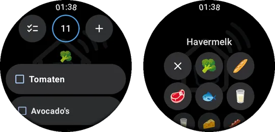

# Help

ShopList toont een boodschappenlijst uit Home Assistant, of een offline lijst die alleen op dit apparaat staat. Wijzigingen worden live gesynchroniseerd met Home Assistant en alle andere apparaten. Zonder verbinding bewaart de app ze en verstuurt ze later.

[toc] Inhoud

## Het hoofdscherm

- Typ nieuwe items in het veld “Nieuw item”. Suggesties komen uit je productgeschiedenis. Het “?” naast het veld kiest de afdeling, “+” voegt het item toe.
- Tik op het vakje om een item af te vinken. Tik op de naam om het te bewerken, ook de afdeling.
- Houd een item ingedrukt en sleep het om de lijst te sorteren. Afgevinkte items komen onderaan en verdwijnen met “Voltooide items wissen”.

### Van lijst wisselen

Tik linksboven op de lijstnaam. Alle takenlijsten uit Home Assistant worden aangeboden; de huidige is aangevinkt.

## Winkels: één volgorde per winkel

Elke winkel is anders ingedeeld. Een winkel onthoudt in welke volgorde je door de afdelingen loopt en welke afdelingen er zijn.

- In de winkel volgt de lijst je route – geen heen-en-weer gelopen.
- Afdelingen die een winkel niet heeft (bijv. een vleeswarentoonbank bij de discounter) kun je verbergen. Ze worden dan niet meer aangeboden voor nieuwe items.
- Voorbeeld: “Supermarkt” met de bakker bij de ingang, “Discounter” met eerst de dranken, “Markt” met alleen verse producten.

## Lijsten en winkels koppelen

Elke lijst heeft zijn winkel. Welke winkel bij welke lijst hoort, stel je in op het tabblad “Lijsten”; lijsten zonder winkel gebruiken de eerste winkel. Wissel je van lijst – in de app of op het horloge –, dan worden de items meteen gesorteerd in de volgorde van die winkel.

- Voorbeeld: lijst “Drogist” met winkel “Discounter”, lijst “Markt” met winkel “Markt”. Eén tik op de lijst en de volgorde klopt.

## De instellingen

De instellingen hebben vijf tabbladen. Je wisselt door op een pictogram te tikken of opzij te vegen. Wijzigingen aan verbinding, lijstweergave en winkels pas je toe met “Opslaan”; schakelaars werken meteen. De (i) naast veel instellingen legt ze uitgebreid uit.

### Verbinding

- Offline lijst: de lijst staat alleen op dit apparaat, zonder Home Assistant.
- Home Assistant-URL en toegangstoken met lange levensduur: de verbinding met je server. Het token maak je in Home Assistant in je profiel onder “Beveiliging”.

### Lijsten

- Lijstweergave: “Eenvoudig” toont één platte lijst, “Gecategoriseerd” groepeert de items per afdeling in de volgorde van de actieve winkel.
- Jouw lijsten: alle takenlijsten uit Home Assistant, elk met zijn winkel.
- Lijsten aanmaken en verwijderen kan alleen met het token van een beheerder. Alleen lijsten van de integratie “Lokale takenlijst” kunnen worden verwijderd – bij andere integraties zou Home Assistant de hele integratie verwijderen.

### Winkels

- Het keuzeveld bepaalt welke winkel je bewerkt. Het potlood hernoemt hem, de prullenbak verwijdert hem – de laatste winkel blijft altijd bestaan.
- Sleep afdelingen aan de greep in de volgorde van je route; de schakelaar verbergt een afdeling.

“+” voegt een winkel toe: nieuw met de standaardvolgorde, of als kopie van een bestaande winkel die je dan alleen nog aanpast.

### Gegevens

- Meldingen: de app reageert ook op de achtergrond op wijzigingen uit Home Assistant.
- Productgeschiedenis: de basis voor suggesties; hier kun je hem wissen.
- Back-up maken en herstellen: een versleuteld bestand met verbinding, winkels en productgeschiedenis.

## Widgets op het startscherm

Vier widgets zetten de lijst op het startscherm: lang drukken op het startscherm → Widgets → HomeShopList. Ze tonen allemaal de huidige lijst van de app en hun grootte is aan te passen.

- „Boodschappenlijst”: lijst met invoerveld, categoriekeuze en lijstwissel.
- „Lijst”: alleen de boodschappenlijst.
- „Snel toevoegen”: alleen het invoerveld met categoriekeuze.
- „Lijstwissel”: toont de huidige lijst met het aantal open items en wisselt die.

### Bediening

- Een tik op het vakje vinkt een item af of weer aan. „Voltooide items wissen” onder de voltooide items verwijdert ze na een bevestiging.
- Een tik op het invoerveld opent de invoer direct boven de widget, met suggesties uit je productgeschiedenis. Die blijft open, zo voeg je meerdere items na elkaar toe.
- Het symbool naast het veld kiest de categorie voor nieuwe items.
- Een tik op de lijstnaam wisselt de lijst. De wissel geldt voor de app en alle widgets.
- Het huis en de pijl rechtsboven openen de app.
- Zolang de app draait, worden de widgets meteen bijgewerkt. Anders als je ze gebruikt en ongeveer elke 30 minuten.

## Offline

- Zonder verbinding kun je gewoon afvinken en toevoegen. Wijzigingen blijven bij hun lijst en worden verstuurd zodra de verbinding terug is.

## Het horloge (Wear OS)

- Het horloge neemt de verbinding, lijsten en winkels automatisch over van de telefoon.
- Linksboven wissel je van lijst; de telefoon wisselt mee. In het midden zie je het aantal open items; „+” voegt een item toe.
- Tik op een item om het af te vinken. „Voltooide items wissen” aan het einde van de lijst verwijdert de afgevinkte items.
- Zonder verbinding werkt het horloge verder met de laatst geladen lijst; de cirkel rond het getal wordt dan oranje. Wijzigingen worden verstuurd zodra de verbinding terug is.
- De tegel toont het aantal open items van de huidige lijst.

### Items toevoegen

- „+” opent de tekstinvoer van het horloge – toetsenbord of spraak, afhankelijk van het horloge – met je meest gebruikte producten als suggesties.
- Bekende producten krijgen automatisch hun categorie.
- Voor nieuwe producten kies je de categorie via het pictogram. Je ziet de categorieën die actief zijn in de winkel van de huidige lijst, in de volgorde van die winkel. ✕ voegt het item zonder categorie toe, „Terug” annuleert.
