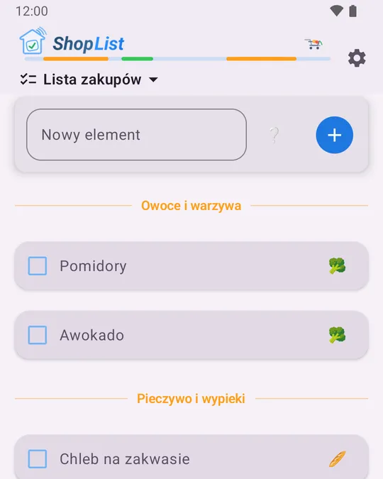
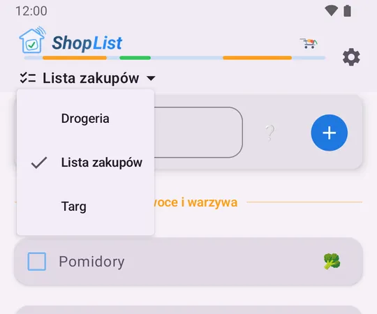
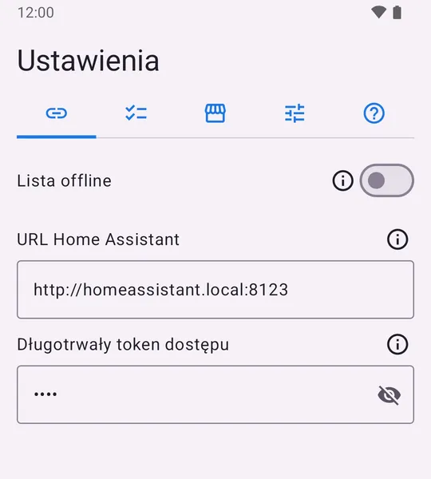
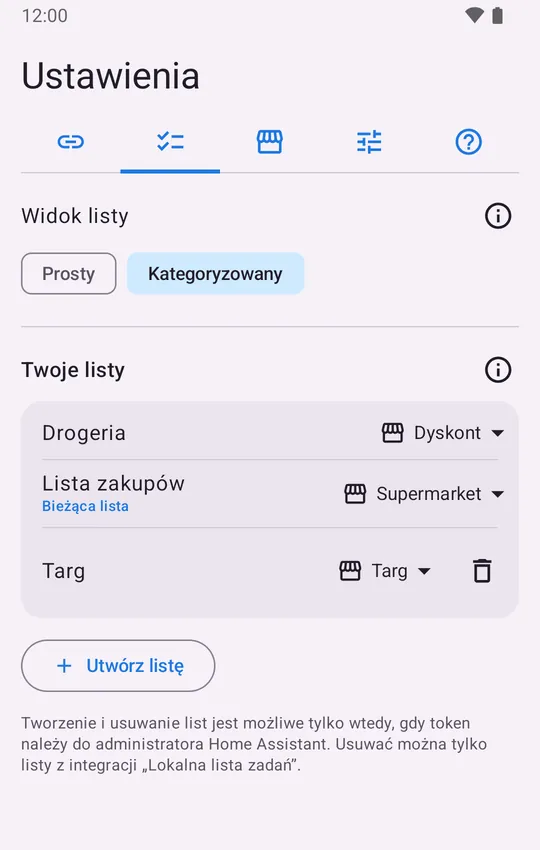
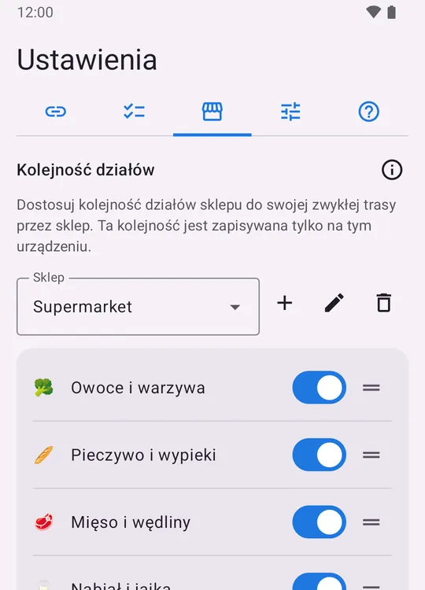
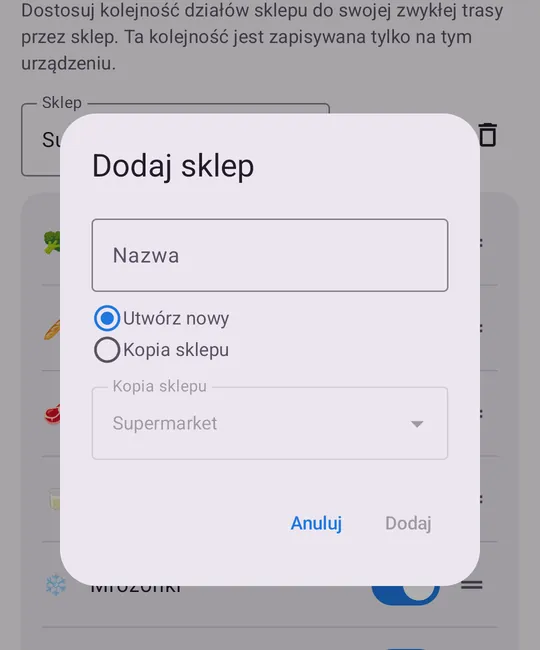
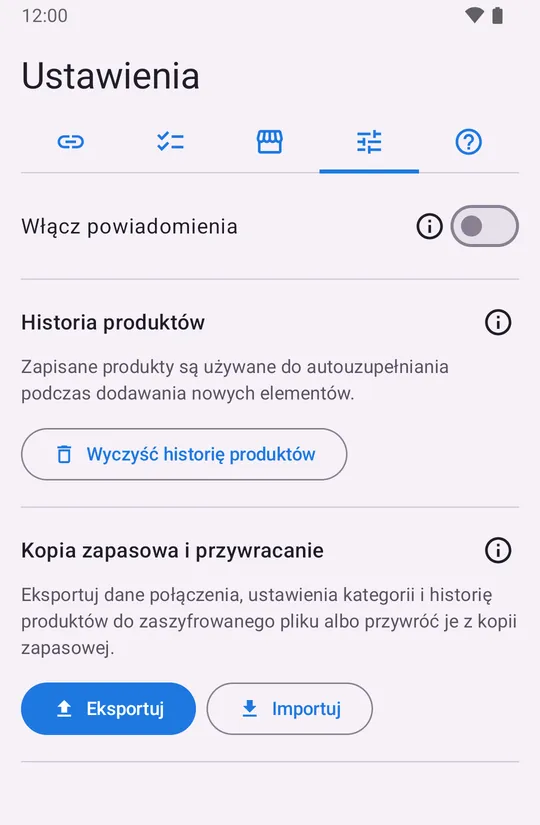
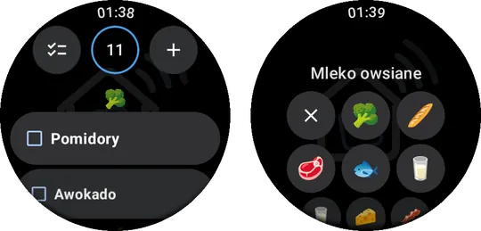

# Pomoc

ShopList pokazuje listę zakupów z Home Assistant albo listę offline zapisaną tylko na tym urządzeniu. Zmiany są na bieżąco synchronizowane z Home Assistant i innymi urządzeniami. Bez połączenia aplikacja je zapamiętuje i wysyła później.

[toc] Spis treści

## Ekran główny

- Nowe pozycje wpisujesz w polu „Nowy element”. Podpowiedzi pochodzą z historii produktów. „?” obok pola wybiera dział sklepu, „+” dodaje pozycję.
- Dotknij pola wyboru, aby odhaczyć pozycję. Dotknij nazwy, aby ją edytować, także jej dział.
- Przytrzymaj pozycję i przeciągnij ją, aby posortować listę. Zakończone pozycje trafiają na dół i usuwa się je przyciskiem „Usuń zakończone”.

### Zmiana listy

Dotknij nazwy listy w lewym górnym rogu. Dostępne są wszystkie listy zadań z Home Assistant; bieżąca jest zaznaczona.

## Sklepy: jedna kolejność na sklep

Każdy sklep jest urządzony inaczej. Sklep zapamiętuje, w jakiej kolejności przechodzisz przez działy i jakie działy w nim są.

- W sklepie lista prowadzi Twoją trasą – bez chodzenia tam i z powrotem.
- Działy, których sklep nie ma (np. stoisko z wędlinami w dyskoncie), możesz ukryć. Nie są wtedy proponowane dla nowych pozycji.
- Przykład: „Supermarket” z piekarnią przy wejściu, „Dyskont” z napojami na początku, „Targ” tylko ze świeżą żywnością.

## Łączenie list i sklepów

Każda lista ma swój sklep. Który sklep należy do której listy, ustawiasz na karcie „Listy”; listy bez sklepu używają pierwszego sklepu. Gdy zmienisz listę – w aplikacji lub na zegarku – jej pozycje od razu układają się w kolejności jej sklepu.

- Przykład: lista „Drogeria” ze sklepem „Dyskont”, lista „Targ” ze sklepem „Targ”. Wystarczy dotknąć listy i kolejność się zgadza.

## Ustawienia

Ustawienia mają pięć kart. Przełączasz je, dotykając ikony lub przesuwając palcem w bok. Zmiany połączenia, widoku listy i sklepów zatwierdzasz przyciskiem „Zapisz”; przełączniki działają od razu. (i) obok wielu ustawień objaśnia je szczegółowo.

### Połączenie

- Lista offline: lista jest tylko na tym urządzeniu, bez Home Assistant.
- Adres URL Home Assistant i długotrwały token dostępu: połączenie z Twoim serwerem. Token utworzysz w Home Assistant w swoim profilu, w sekcji „Bezpieczeństwo”.

### Listy

- Widok listy: „Prosty” pokazuje jedną płaską listę, „Kategoryzowany” grupuje pozycje według działów w kolejności aktywnego sklepu.
- Twoje listy: wszystkie listy zadań z Home Assistant, każda ze swoim sklepem.
- Tworzenie i usuwanie list wymaga tokenu administratora. Usuwać można tylko listy z integracji „Lokalna lista zadań” – w innych integracjach Home Assistant usunąłby całą integrację.

### Sklepy

- Pole wyboru określa, który sklep edytujesz. Ołówek zmienia jego nazwę, kosz go usuwa – ostatni sklep zawsze zostaje.
- Przeciągnij działy za uchwyt w kolejności swojej trasy; przełącznik ukrywa dział.

„+” dodaje sklep: nowy z domyślną kolejnością albo jako kopię istniejącego sklepu, którą potem tylko dopasowujesz.

### Dane

- Powiadomienia: aplikacja reaguje także w tle na zmiany z Home Assistant.
- Historia produktów: podstawa podpowiedzi; tutaj można ją usunąć.
- Kopia zapasowa i przywracanie: zaszyfrowany plik z połączeniem, sklepami i historią produktów.

## Widżety na ekranie głównym

Cztery widżety umieszczają listę na ekranie głównym: przytrzymaj ekran główny → Widżety → HomeShopList. Wszystkie pokazują bieżącą listę aplikacji, a ich rozmiar można zmieniać.

- „Lista zakupów”: lista z polem wpisywania, wyborem kategorii i zmianą listy.
- „Lista”: tylko lista zakupów.
- „Szybkie dodawanie”: tylko pole wpisywania z wyborem kategorii.
- „Wybór listy”: pokazuje bieżącą listę z liczbą otwartych elementów i ją zmienia.

### Obsługa

- Dotknięcie pola wyboru odhacza element lub cofa odhaczenie. „Usuń zakończone” pod zakończonymi elementami usuwa je po potwierdzeniu.
- Dotknięcie pola wpisywania otwiera wpisywanie tuż nad widżetem, z podpowiedziami z historii produktów. Pozostaje ono otwarte, więc możesz dodać kilka elementów po kolei.
- Symbol obok pola wybiera kategorię nowych elementów.
- Dotknięcie nazwy listy zmienia listę. Zmiana dotyczy aplikacji i wszystkich widżetów.
- Domek i strzałka w prawym górnym rogu otwierają aplikację.
- Gdy aplikacja działa, widżety aktualizują się od razu. W przeciwnym razie przy użyciu i mniej więcej co 30 minut.

## Bez połączenia

- Bez połączenia możesz dalej odhaczać i dodawać pozycje. Zmiany pozostają przypisane do swojej listy i są wysyłane, gdy tylko połączenie wróci.

## Zegarek (Wear OS)

- Zegarek automatycznie przejmuje z telefonu połączenie, listy i sklepy.
- W lewym górnym rogu zmieniasz listę – telefon zmienia ją razem z zegarkiem. Pośrodku widać liczbę pozostałych pozycji, „+” dodaje pozycję.
- Dotknij pozycji, aby ją odhaczyć. „Usuń zakończone” na końcu listy usuwa odhaczone pozycje.
- Bez połączenia zegarek działa dalej z ostatnio wczytaną listą; kółko wokół liczby staje się pomarańczowe. Zmiany są wysyłane, gdy tylko połączenie wróci.
- Kafelek pokazuje liczbę pozostałych pozycji bieżącej listy.

### Dodawanie pozycji

- „+” otwiera wprowadzanie tekstu na zegarku – klawiaturę lub głos, zależnie od zegarka – z najczęściej używanymi produktami jako podpowiedziami.
- Znane produkty automatycznie dostają swoją kategorię.
- Dla nowych produktów wybierasz kategorię za pomocą ikony. Widoczne są kategorie aktywne w sklepie bieżącej listy, w jego kolejności. ✕ dodaje pozycję bez kategorii, „Wstecz” anuluje.
