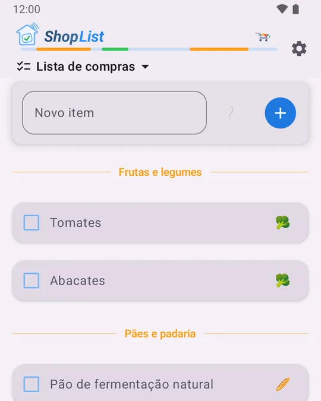
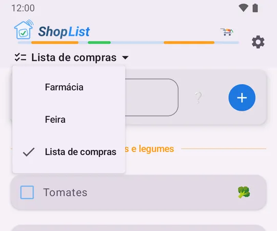
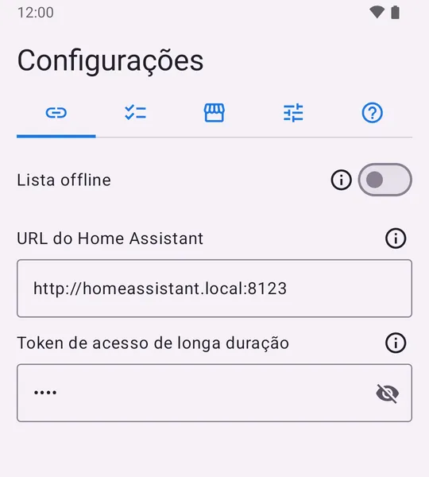
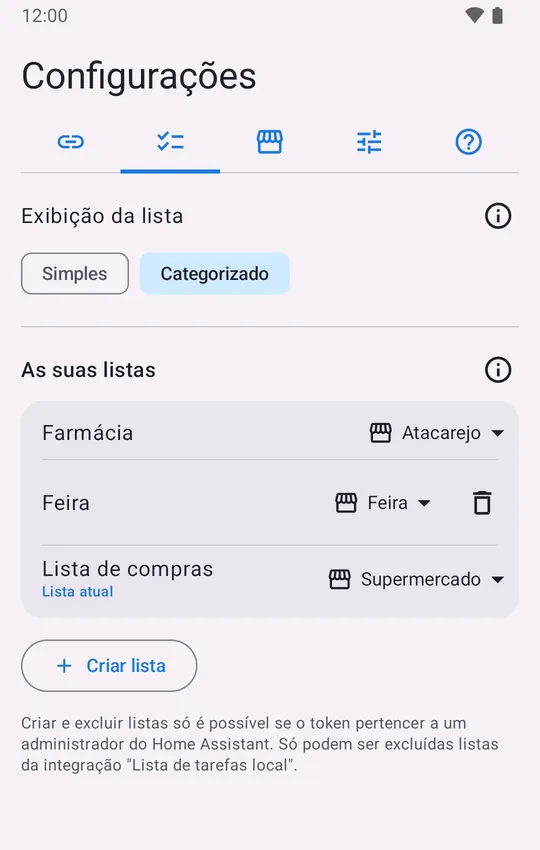
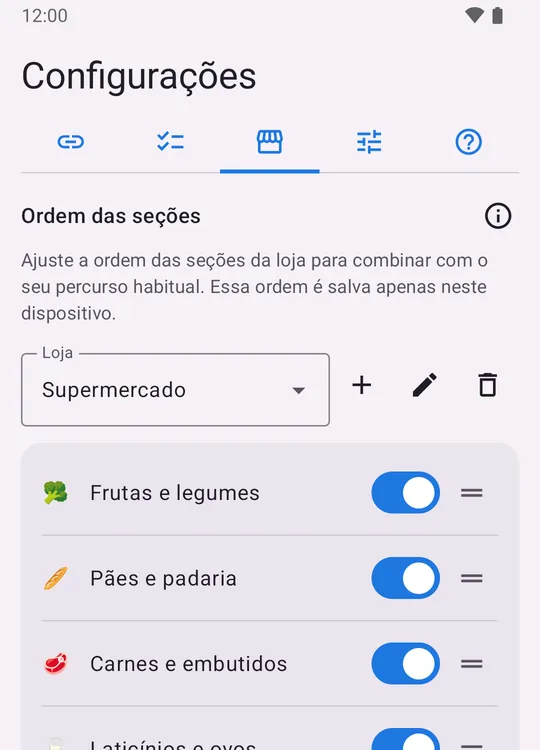
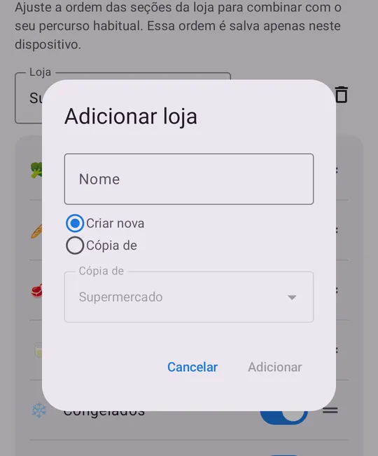
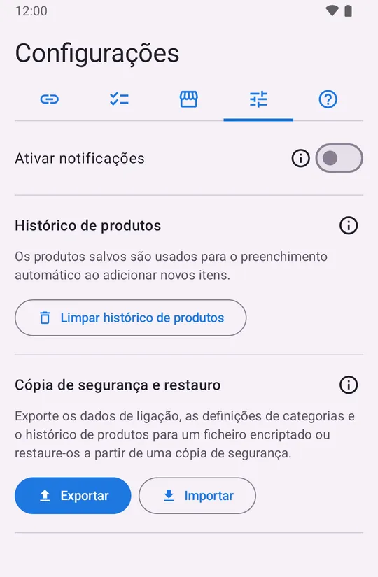
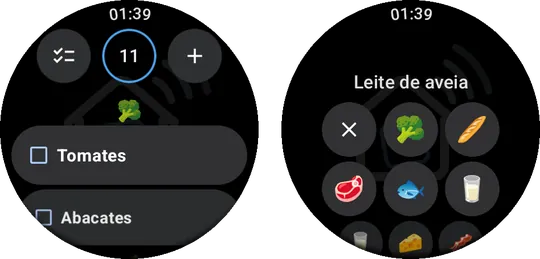

# Ajuda

O ShopList mostra uma lista de compras do Home Assistant – ou uma lista offline salva apenas neste dispositivo. As alterações são sincronizadas em tempo real com o Home Assistant e com os outros dispositivos. Sem conexão, o app as guarda e envia depois.

[toc] Índice

## A tela principal

- Digite novos itens no campo “Novo item”. As sugestões vêm do seu histórico de produtos. O “?” ao lado do campo escolhe a seção da loja e o “+” adiciona o item.
- Toque na caixa de seleção para marcar um item. Toque no nome para editá-lo, inclusive a seção.
- Mantenha um item pressionado e arraste-o para ordenar a lista. Os itens concluídos ficam embaixo e são removidos com “Limpar concluídos”.

### Mudar de lista

Toque no nome da lista no canto superior esquerdo. São oferecidas todas as listas de tarefas do Home Assistant; a atual aparece marcada.

## Lojas: uma ordem para cada estabelecimento

Cada estabelecimento é organizado de um jeito. Uma loja memoriza em que ordem você percorre as seções e quais seções existem.

- Na loja, a lista segue o seu percurso – sem ir e voltar.
- Seções que um estabelecimento não tem (por ex. frios no atacarejo) podem ser ocultadas. Elas deixam de ser oferecidas para novos itens.
- Exemplo: “Supermercado” com a padaria na entrada, “Atacarejo” com as bebidas primeiro, “Feira” só com produtos frescos.

## Ligar listas e lojas

Cada lista tem a sua loja. A loja de cada lista é definida na guia “Listas”; listas sem loja usam a primeira. Ao mudar de lista – no app ou no relógio –, os itens são ordenados na hora conforme a loja dela.

- Exemplo: lista “Farmácia” com a loja “Atacarejo”, lista “Feira” com a loja “Feira”. Basta tocar na lista e a ordem está certa.

## As configurações

As configurações têm cinco guias. Mude tocando em um ícone ou deslizando para o lado. Alterações na conexão, na exibição da lista e nas lojas são aplicadas com “Salvar”; os interruptores agem na hora. O (i) ao lado de muitas configurações explica cada uma em detalhe.

### Conexão

- Lista offline: a lista fica só neste dispositivo, sem Home Assistant.
- URL do Home Assistant e token de acesso de longa duração: a conexão com o seu servidor. Crie o token no Home Assistant, no seu perfil, em “Segurança”.

### Listas

- Exibição da lista: “Simples” mostra uma lista única, “Categorizado” agrupa os itens por seção na ordem da loja ativa.
- Suas listas: todas as listas de tarefas do Home Assistant, cada uma com sua loja.
- Criar e excluir listas exige o token de um administrador. Só podem ser excluídas listas da integração “Lista de tarefas local” – em outras integrações o Home Assistant removeria a integração inteira.

### Lojas

- O campo de seleção escolhe qual loja você edita. O lápis muda o nome, a lixeira exclui – a última loja sempre permanece.
- Arraste as seções pela alça na ordem do seu percurso; o interruptor oculta uma seção.

“+” adiciona uma loja: nova com a ordem padrão ou como cópia de uma loja existente, que você só ajusta.

### Dados

- Notificações: o app reage também em segundo plano às alterações do Home Assistant.
- Histórico de produtos: a base das sugestões; pode ser apagado aqui.
- Cópia de segurança e restauro: um arquivo criptografado com a conexão, as lojas e o histórico de produtos.

## Offline

- Sem conexão você continua marcando e adicionando itens. As alterações ficam ligadas à sua lista e são enviadas assim que a conexão volta.

## O relógio (Wear OS)

- O relógio recebe a conexão, as listas e as lojas do celular automaticamente.
- No canto superior esquerdo você muda a lista; o celular muda junto. No meio aparece o número de itens em aberto; “+” adiciona um item.
- Toque em um item para marcá-lo. “Limpar concluídos” no fim da lista remove os itens marcados.
- Sem conexão, o relógio continua com a última lista carregada; o círculo em volta do número fica laranja. As alterações são enviadas assim que a conexão volta.
- O bloco mostra o número de itens em aberto da lista atual.

### Adicionar itens

- “+” abre a entrada de texto do relógio – teclado ou voz, conforme o relógio – com seus produtos mais usados como sugestões.
- Produtos conhecidos recebem a categoria automaticamente.
- Para produtos novos você escolhe a categoria pelo ícone. Aparecem as categorias ativas na loja da lista atual, na ordem dela. ✕ adiciona o item sem categoria, “Voltar” cancela.
