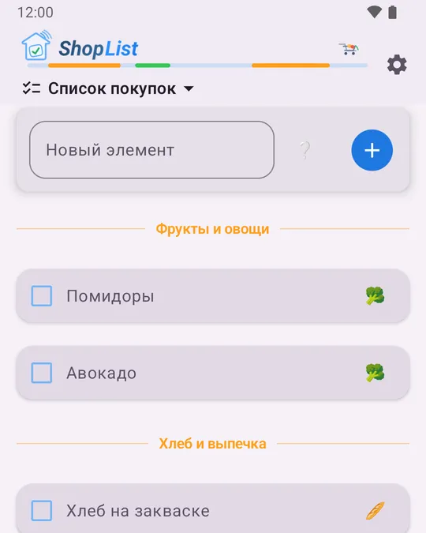
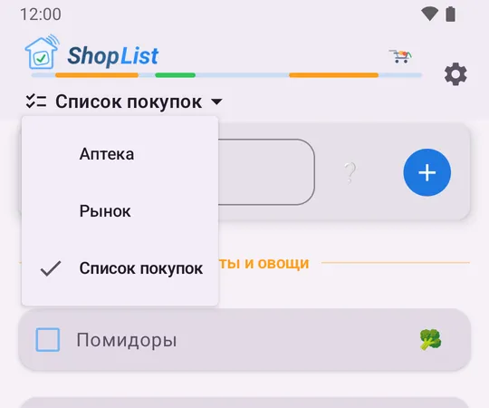
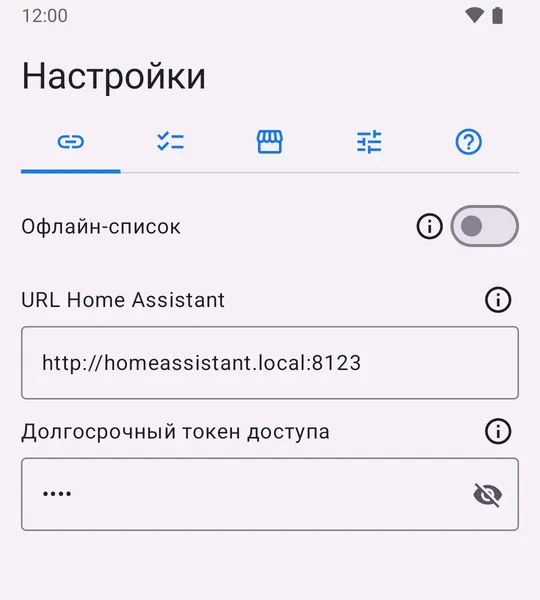
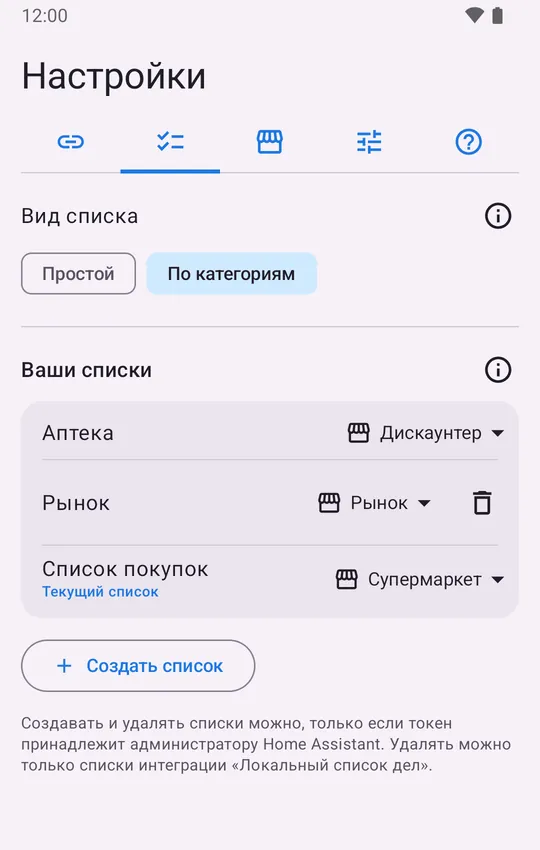
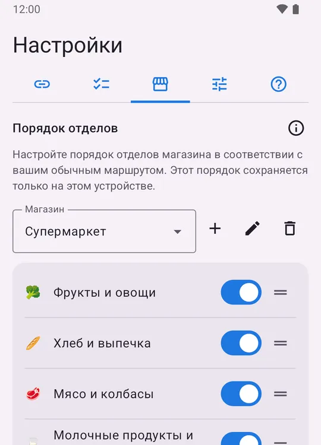
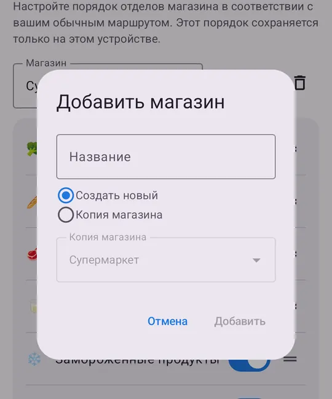
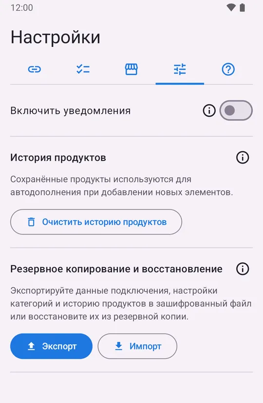
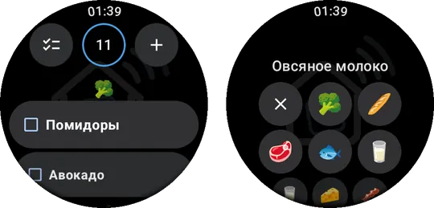

# Справка

ShopList показывает список покупок из Home Assistant или офлайн-список, который хранится только на этом устройстве. Изменения в реальном времени синхронизируются с Home Assistant и другими устройствами. Без подключения приложение сохраняет их и отправляет позже.

[toc] Содержание

## Главный экран

- Новые товары вводите в поле «Новый элемент». Подсказки берутся из истории продуктов. «?» рядом с полем выбирает отдел магазина, «+» добавляет товар.
- Нажмите на флажок, чтобы отметить товар. Нажмите на название, чтобы изменить его, в том числе отдел.
- Удерживайте товар и перетащите его, чтобы отсортировать список. Отмеченные товары собираются внизу и удаляются кнопкой «Очистить завершённые».

### Смена списка

Нажмите на название списка слева вверху. Будут показаны все списки дел из Home Assistant; текущий отмечен галочкой.

## Магазины: свой порядок для каждого

Каждый магазин устроен по-своему. Магазин хранит, в каком порядке вы проходите отделы и какие отделы в нём есть.

- В магазине список ведёт по вашему маршруту – без лишних хождений.
- Отделы, которых в магазине нет (например, кулинария в дискаунтере), можно скрыть. Для новых товаров они больше не предлагаются.
- Пример: «Супермаркет» с пекарней у входа, «Дискаунтер» с напитками в начале, «Рынок» только со свежими продуктами.

## Связь списков и магазинов

У каждого списка свой магазин. Какой магазин относится к какому списку, задаётся на вкладке «Списки»; списки без магазина используют первый магазин. При смене списка – в приложении или на часах – товары сразу сортируются в порядке его магазина.

- Пример: список «Аптека» с магазином «Дискаунтер», список «Рынок» с магазином «Рынок». Достаточно нажать на список – и порядок верный.

## Настройки

В настройках пять вкладок. Переключайтесь нажатием на значок или свайпом в сторону. Изменения подключения, вида списка и магазинов применяются кнопкой «Сохранить»; переключатели действуют сразу. Значок (i) рядом со многими настройками подробно их объясняет.

### Подключение

- Офлайн-список: список хранится только на этом устройстве, без Home Assistant.
- URL Home Assistant и долгосрочный токен доступа: подключение к вашему серверу. Токен создаётся в Home Assistant в профиле, в разделе «Безопасность».

### Списки

- Вид списка: «Простой» показывает единый список, «По категориям» группирует товары по отделам в порядке активного магазина.
- Ваши списки: все списки дел из Home Assistant, у каждого свой магазин.
- Создавать и удалять списки можно только с токеном администратора. Удалять можно лишь списки интеграции «Локальный список дел» – в других интеграциях Home Assistant удалил бы всю интеграцию.

### Магазины

- Поле выбора определяет, какой магазин вы редактируете. Карандаш переименовывает, корзина удаляет – последний магазин всегда остаётся.
- Перетаскивайте отделы за маркер в порядке вашего маршрута; переключатель скрывает отдел.

«+» добавляет магазин: новый с порядком по умолчанию или как копию существующего, которую остаётся лишь подправить.

### Данные

- Уведомления: приложение реагирует на изменения из Home Assistant и в фоне.
- История продуктов: основа для подсказок; здесь её можно очистить.
- Резервное копирование и восстановление: зашифрованный файл с подключением, магазинами и историей продуктов.

## Виджеты на главном экране

Четыре виджета выводят список на главный экран: долгое нажатие на главный экран → Виджеты → HomeShopList. Все они показывают текущий список приложения, их размер можно менять.

- «Список покупок»: список с полем ввода, выбором категории и сменой списка.
- «Список»: только список покупок.
- «Быстрое добавление»: только поле ввода с выбором категории.
- «Выбор списка»: показывает текущий список с числом открытых элементов и меняет его.

### Использование

- Нажатие на флажок отмечает элемент выполненным или снимает отметку. «Очистить завершённые» под выполненными элементами удаляет их после подтверждения.
- Нажатие на поле ввода открывает ввод прямо над виджетом, с подсказками из истории продуктов. Оно остаётся открытым, так что можно добавить несколько элементов подряд.
- Символ рядом с полем выбирает категорию для новых элементов.
- Нажатие на название списка меняет список. Смена действует для приложения и всех виджетов.
- Домик и стрелка справа вверху открывают приложение.
- Пока приложение работает, виджеты обновляются сразу. Иначе — при использовании и примерно каждые 30 минут.

## Без подключения

- Без подключения можно и дальше отмечать и добавлять товары. Изменения остаются привязаны к своему списку и отправляются, как только подключение восстановится.

## Часы (Wear OS)

- Часы автоматически получают с телефона подключение, списки и магазины.
- Слева вверху меняется список – телефон переключается вместе с часами. В центре видно число оставшихся товаров, «+» добавляет товар.
- Коснитесь товара, чтобы отметить его. «Очистить завершённые» в конце списка убирает отмеченные товары.
- Без подключения часы продолжают работать с последним загруженным списком; круг вокруг числа становится оранжевым. Изменения отправляются, как только подключение восстановится.
- Карточка показывает число оставшихся товаров текущего списка.

### Добавление товаров

- «+» открывает ввод текста на часах – клавиатуру или голос, в зависимости от часов – с вашими самыми частыми товарами в качестве подсказок.
- Известные товары автоматически получают свою категорию.
- Для новых товаров категория выбирается по значку. Показаны категории, включённые в магазине текущего списка, в его порядке. ✕ добавляет товар без категории, «Назад» отменяет.
