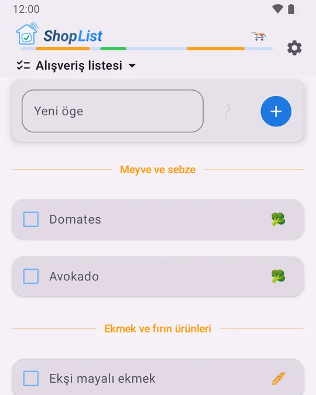
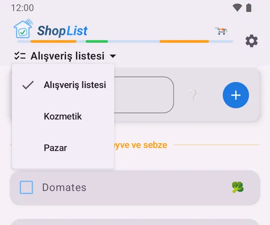
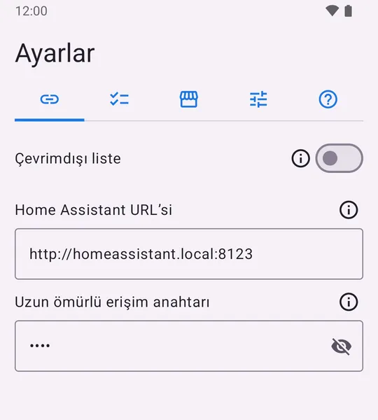
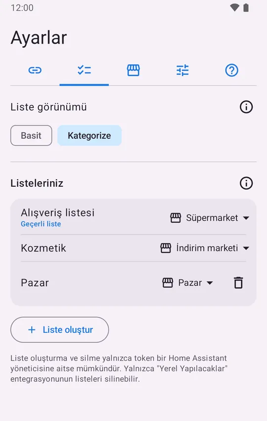
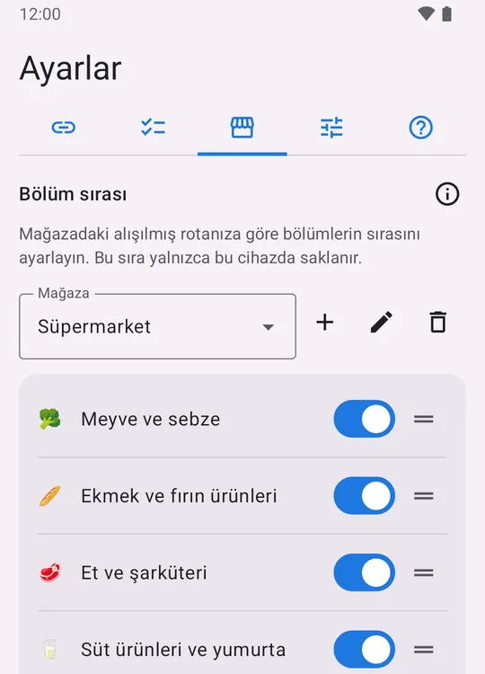
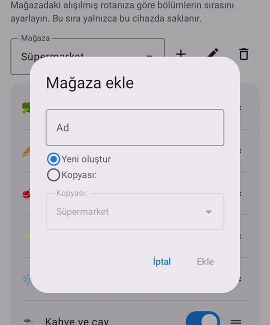
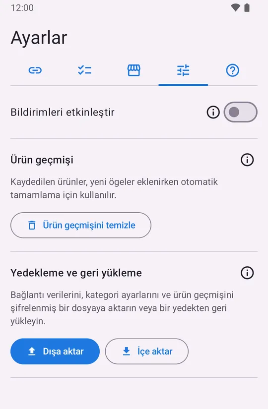
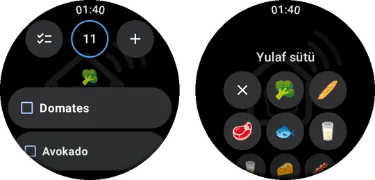

# Yardım

ShopList, Home Assistant’taki bir alışveriş listesini ya da yalnızca bu cihazda saklanan çevrimdışı bir listeyi gösterir. Değişiklikler Home Assistant ve diğer cihazlarla anında eşitlenir. Bağlantı yoksa uygulama değişiklikleri saklar ve daha sonra gönderir.

[toc] İçindekiler

## Ana ekran

- Yeni ögeleri “Yeni öge” alanına yazın. Öneriler ürün geçmişinizden gelir. Alanın yanındaki “?” mağaza bölümünü seçer, “+” ögeyi ekler.
- Bir ögeyi işaretlemek için onay kutusuna dokunun. Bölümü dahil düzenlemek için adına dokunun.
- Listeyi sıralamak için bir ögeye basılı tutup sürükleyin. Tamamlanan ögeler aşağıda toplanır ve “Tamamlananları temizle” ile kaldırılır.

### Listeyi değiştirme

Sol üstteki liste adına dokunun. Home Assistant’taki tüm yapılacaklar listeleri sunulur; geçerli liste işaretlidir.

## Mağazalar: her dükkân için bir sıra

Her dükkânın düzeni farklıdır. Bir mağaza, bölümleri hangi sırayla dolaştığınızı ve hangi bölümlerin bulunduğunu saklar.

- Dükkânda liste rotanızı izler – boşuna gidip gelmezsiniz.
- Dükkânda olmayan bölümleri (ör. indirim marketindeki şarküteri) gizleyebilirsiniz. Artık yeni ögeler için önerilmezler.
- Örnek: girişte fırını olan “Süpermarket”, içecekleri önde olan “İndirim marketi”, yalnızca taze gıda olan “Pazar”.

## Listeleri ve mağazaları bağlama

Her listenin bir mağazası vardır. Hangi mağazanın hangi listeye ait olduğu “Listeler” sekmesinde belirlenir; mağazası olmayan listeler ilk mağazayı kullanır. Listeyi değiştirdiğinizde – uygulamada veya saatte – ögeler hemen o mağazanın sırasına göre dizilir.

- Örnek: “Kozmetik” listesi ile “İndirim marketi” mağazası, “Pazar” listesi ile “Pazar” mağazası. Listeye dokunmanız yeterli, sıra doğru olur.

## Ayarlar

Ayarlarda beş sekme vardır. Bir simgeye dokunarak veya yana kaydırarak geçiş yaparsınız. Bağlantı, liste görünümü ve mağaza değişiklikleri “Kaydet” ile uygulanır; anahtarlar hemen etkili olur. Birçok ayarın yanındaki (i) ayrıntılı açıklama gösterir.

### Bağlantı

- Çevrimdışı liste: liste Home Assistant olmadan yalnızca bu cihazda tutulur.
- Home Assistant URL’si ve uzun ömürlü erişim anahtarı: sunucunuzla bağlantı. Token’ı Home Assistant’ta profilinizde “Güvenlik” altında oluşturursunuz.

### Listeler

- Liste görünümü: “Basit” tek bir düz liste gösterir, “Kategorize” ögeleri etkin mağazanın sırasına göre bölümlere ayırır.
- Listeleriniz: Home Assistant’taki tüm yapılacaklar listeleri ve her birinin mağazası.
- Liste oluşturmak ve silmek bir yöneticinin token’ını gerektirir. Yalnızca “Yerel Yapılacaklar” entegrasyonunun listeleri silinebilir – diğer entegrasyonlarda Home Assistant tüm entegrasyonu kaldırırdı.

### Mağazalar

- Seçim alanı hangi mağazayı düzenleyeceğinizi belirler. Kalem yeniden adlandırır, çöp kutusu siler – son mağaza her zaman kalır.
- Bölümleri tutamaktan rotanızın sırasına sürükleyin; anahtar bir bölümü gizler.

“+” bir mağaza ekler: varsayılan sırayla yeni ya da yalnızca uyarlayacağınız mevcut bir mağazanın kopyası olarak.

### Veriler

- Bildirimler: uygulama arka planda da Home Assistant’taki değişikliklere tepki verir.
- Ürün geçmişi: önerilerin temeli; burada silinebilir.
- Yedekleme ve geri yükleme: bağlantıyı, mağazaları ve ürün geçmişini içeren şifreli bir dosya.

## Ana ekran widget'ları

Dört widget listeyi ana ekrana getirir: ana ekrana uzun basın → Widget'lar → HomeShopList. Hepsi uygulamanın geçerli listesini gösterir ve boyutları değiştirilebilir.

- "Alışveriş listesi": giriş alanı, kategori seçimi ve liste değiştirme içeren liste.
- "Liste": yalnızca alışveriş listesi.
- "Hızlı ekle": yalnızca kategori seçimli giriş alanı.
- "Liste seçimi": geçerli listeyi açık öge sayısıyla gösterir ve değiştirir.

### Kullanım

- Kutuya dokunmak bir ögeyi tamamlandı olarak işaretler veya işareti kaldırır. Tamamlanan ögelerin altındaki "Tamamlananları temizle" onaydan sonra onları siler.
- Giriş alanına dokunmak, girişi doğrudan widget'ın üzerinde, ürün geçmişinden önerilerle açar. Açık kalır, böylece art arda birkaç öge ekleyebilirsiniz.
- Alanın yanındaki simge yeni ögelerin kategorisini seçer.
- Liste adına dokunmak listeyi değiştirir. Değişiklik uygulama ve tüm widget'lar için geçerlidir.
- Sağ üstteki ev ve ok uygulamayı açar.
- Uygulama çalışırken widget'lar hemen güncellenir. Aksi halde kullandığınızda ve yaklaşık her 30 dakikada bir.

## Çevrimdışı

- Bağlantı olmadan da işaretlemeye ve eklemeye devam edebilirsiniz. Değişiklikler kendi listelerine bağlı kalır ve bağlantı gelir gelmez gönderilir.

## Saat (Wear OS)

- Saat bağlantıyı, listeleri ve mağazaları telefondan otomatik alır.
- Sol üstte listeyi değiştirirsiniz; telefon da birlikte değişir. Ortada açık öge sayısı görünür, „+“ bir öge ekler.
- Bir ögeye dokunarak işaretleyin. Listenin sonundaki „Tamamlananları temizle“ işaretli ögeleri kaldırır.
- Bağlantı yokken saat son yüklenen listeyle çalışmaya devam eder; sayının etrafındaki daire turuncu olur. Değişiklikler bağlantı gelir gelmez gönderilir.
- Kutucuk geçerli listenin açık öge sayısını gösterir.

### Öge ekleme

- „+“ saatin metin girişini açar – saate göre klavye veya ses – ve en çok kullandığınız ürünleri öneri olarak gösterir.
- Bilinen ürünler kategorisini otomatik alır.
- Yeni ürünlerde kategoriyi simgesiyle seçersiniz. Geçerli listenin mağazasında etkin olan kategoriler, o mağazanın sırasıyla gösterilir. ✕ ögeyi kategorisiz ekler, „Geri“ iptal eder.
