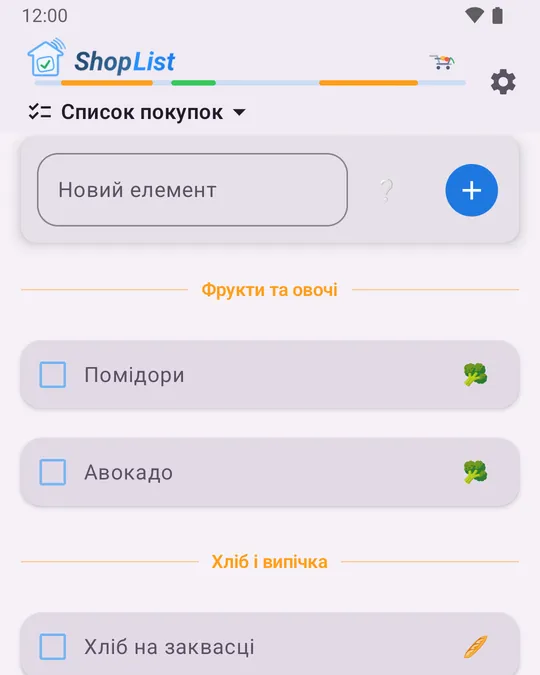
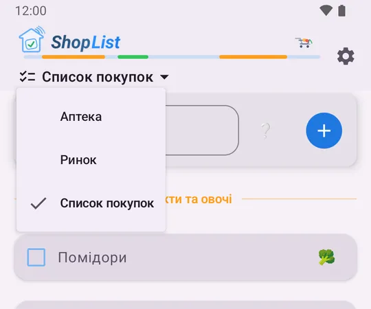
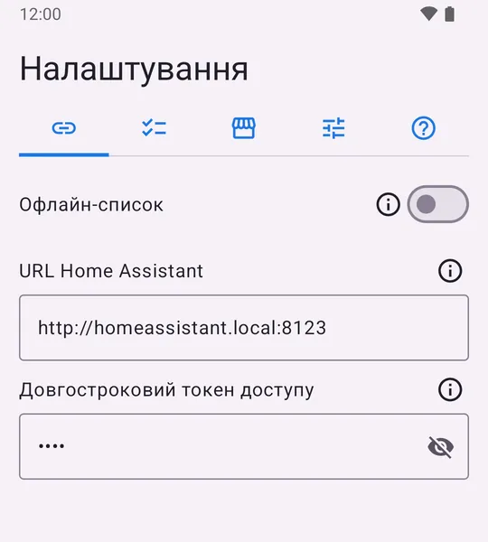
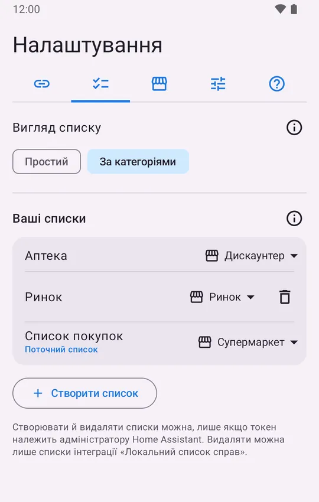
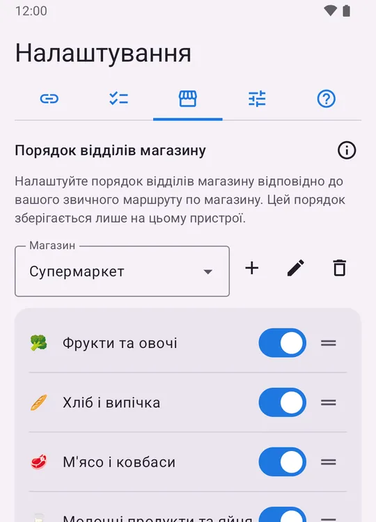
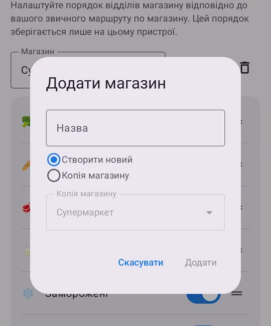
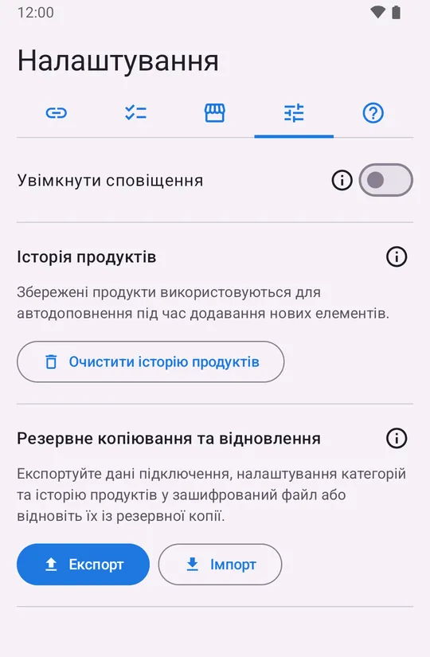
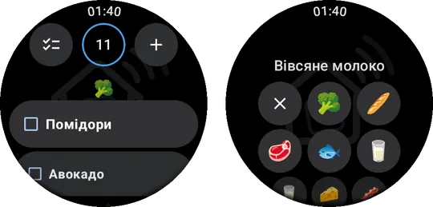

# Довідка

ShopList показує список покупок із Home Assistant або офлайн-список, що зберігається лише на цьому пристрої. Зміни в реальному часі синхронізуються з Home Assistant та іншими пристроями. Без підключення застосунок зберігає їх і надсилає пізніше.

[toc] Зміст

## Головний екран

- Нові товари вводьте в поле «Новий елемент». Підказки беруться з історії продуктів. «?» поруч із полем вибирає відділ магазину, «+» додає товар.
- Торкніться прапорця, щоб позначити товар. Торкніться назви, щоб змінити її, зокрема відділ.
- Утримуйте товар і перетягніть його, щоб відсортувати список. Позначені товари збираються внизу й видаляються кнопкою «Очистити виконані».

### Зміна списку

Торкніться назви списку вгорі ліворуч. Буде показано всі списки справ із Home Assistant; поточний позначено галочкою.

## Магазини: свій порядок для кожного

Кожен магазин облаштований по-своєму. Магазин зберігає, у якому порядку ви проходите відділи і які відділи в ньому є.

- У магазині список веде вашим маршрутом – без зайвих ходінь.
- Відділи, яких у магазині немає (наприклад, кулінарія в дискаунтері), можна приховати. Для нових товарів їх більше не пропонують.
- Приклад: «Супермаркет» із пекарнею біля входу, «Дискаунтер» із напоями на початку, «Ринок» лише зі свіжими продуктами.

## Зв’язок списків і магазинів

Кожен список має свій магазин. Який магазин належить до якого списку, задається на вкладці «Списки»; списки без магазину використовують перший магазин. Під час зміни списку – у застосунку чи на годиннику – пункти одразу сортуються в порядку його магазину.

- Приклад: список «Аптека» з магазином «Дискаунтер», список «Ринок» з магазином «Ринок». Достатньо торкнутися списку – і порядок правильний.

## Налаштування

У налаштуваннях п’ять вкладок. Перемикайтеся торканням значка або свайпом убік. Зміни підключення, вигляду списку й магазинів застосовуються кнопкою «Зберегти»; перемикачі діють одразу. Значок (i) біля багатьох налаштувань докладно їх пояснює.

### Підключення

- Офлайн-список: список зберігається лише на цьому пристрої, без Home Assistant.
- URL Home Assistant і довгостроковий токен доступу: підключення до вашого сервера. Токен створюється в Home Assistant у профілі, у розділі «Безпека».

### Списки

- Вигляд списку: «Простий» показує один суцільний список, «За категоріями» групує товари за відділами в порядку активного магазину.
- Ваші списки: усі списки справ із Home Assistant, кожен зі своїм магазином.
- Створювати й видаляти списки можна лише з токеном адміністратора. Видаляти можна тільки списки інтеграції «Локальний список справ» – в інших інтеграціях Home Assistant видалив би всю інтеграцію.

### Магазини

- Поле вибору визначає, який магазин ви редагуєте. Олівець перейменовує, кошик видаляє – останній магазин завжди залишається.
- Перетягуйте відділи за маркер у порядку вашого маршруту; перемикач приховує відділ.

«+» додає магазин: новий із порядком за замовчуванням або як копію наявного, яку лишається тільки підправити.

### Дані

- Сповіщення: застосунок реагує на зміни з Home Assistant і у фоновому режимі.
- Історія продуктів: основа для підказок; тут її можна очистити.
- Резервне копіювання та відновлення: зашифрований файл із підключенням, магазинами та історією продуктів.

## Без підключення

- Без підключення можна далі позначати й додавати товари. Зміни лишаються прив’язаними до свого списку й надсилаються, щойно підключення відновиться.

## Годинник (Wear OS)

- Годинник автоматично отримує з телефона підключення, списки й магазини.
- Ліворуч угорі змінюється список – телефон перемикається разом із годинником. Посередині видно кількість товарів, що лишилися, «+» додає товар.
- Торкніться товару, щоб позначити його. «Очистити виконані» в кінці списку прибирає позначені товари.
- Без підключення годинник працює далі з останнім завантаженим списком; коло навколо числа стає помаранчевим. Зміни надсилаються, щойно підключення відновиться.
- Плитка показує кількість товарів, що лишилися, у поточному списку.

### Додавання товарів

- «+» відкриває введення тексту на годиннику – клавіатуру або голос, залежно від годинника – з вашими найчастішими товарами як підказками.
- Відомі товари автоматично отримують свою категорію.
- Для нових товарів категорію вибирають за значком. Показано категорії, увімкнені в магазині поточного списку, у його порядку. ✕ додає товар без категорії, «Назад» скасовує.
